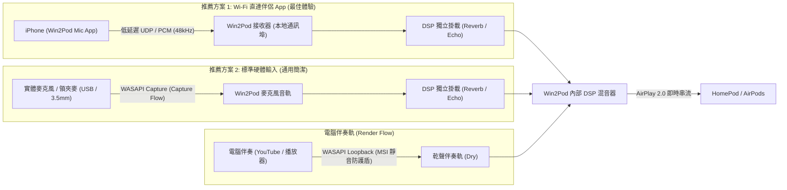

# Windows 藍牙 A2DP 音訊路由與雙軌 KTV 混音實機探測研究報告

**文件版本**：v1.0  
**測試日期**：2026-11-15 ~ 2026-11-16  
**目標專案**：Win2Pod Bridge  
**代碼存檔分支**：[`feature/a2dp-ktv-backup`](https://github.com/mesmerli/win2pod-bridge/tree/feature/a2dp-ktv-backup) (Commit: `1615be2`)  
**實機測試環境**：
- 作業系統：Windows 11 Pro (x64)
- 伴奏端點（電腦主音效）：`MSI MP341CQ (NVIDIA High Definition Audio)`
- 輔助/人聲端點：`喇叭 (C-Media(R) Audio USB Sound Card)`
- 藍牙發射端（人聲輸入）：`iPhone 15 Pro ("LeoBaiPhone")` (A2DP Source)
- 目標串流接收端：`Apple HomePod ("書房")` / `AirPods`

---

## 1. 背景與研究目標

### 1.1 需求場景：無線麥克風與獨立 DSP 雙軌混音 (KTV Mode)
Win2Pod Bridge 的目標是將 Windows PC 全系統音訊無縫串流至 Apple HomePod / AirPods。在進階應用場景（如家庭 KTV 或語音直播）中，使用者期望將 iPhone 作為無線麥克風，其架構需求如下：
1. **軌道 A（iPhone 人聲軌）**：經由藍牙 A2DP 輸入電腦，Win2Pod 獨佔擷取後，單獨掛載 **Echo / Reverb（迴音/混響）** DSP 效果器。
2. **軌道 B（電腦伴奏軌）**：電腦上播放的 YouTube 或伴奏音樂，維持乾聲（Dry Audio，不加迴音）。
3. **內部 DSP 混音**：在 Win2Pod 記憶體中將「濕人聲」與「乾伴奏」依比例即時混合。
4. **輸出**：將混音後的純淨 PCM 即時透過 AirPlay 串流至 HomePod 或 AirPods，同時**實體電腦喇叭必須完全靜音、零漏音、不產生迴授嘯叫**。

### 1.2 核心技術挑戰
- **音訊隔離**：如何阻止電腦伴奏音訊與 iPhone 人聲混在同一個端點？
- **A2DP 攔截機制**：Windows 藍牙 A2DP Sink 是否能被指派至專屬虛擬/實體音效卡，而不干擾電腦主播放端點？
- **實體防護**：電腦實體喇叭靜音（Mute）後，WASAPI Loopback 是否仍具備音訊擷取能力？

---

## 2. 理論假說與架構設計

為實現上述目標，我們先後提出了三種架構假說：

```mermaid
flowchart TD
    subgraph 假說A_ProcessLoopback["假說 A: 程序級捕捉 (Process Loopback)"]
        A1["iPhone A2DP"] --> A2["Audiosrv (PID 4272)"]
        A2 --> A3["WASAPI Process Loopback"]
        A3 --> A4["擷取人聲"]
    end

    subgraph 假說B_DualEndpoint["假說 B: 端點隔離 + 替身鎖定 (Stand-in Proxy)"]
        B1["Windows 預設設為 C-Media"] --> B2["A2DP 連線至 C-Media"]
        B2 --> B3["預設切回 MSI 伴奏軌"]
        B3 --> B4["A2DP 是否固定在 C-Media？"]
    end

    subgraph 假說C_VBCable["假說 C: 虛擬音效卡 (VB-CABLE Driver)"]
        C1["CABLE Input (虛擬)"] --> C2["A2DP 認定虛擬端點"]
        C2 --> C3["實體喇叭維持獨立伴奏"]
    end
```



---

## 3. 實機探測工具設計 (`probe_bt_audio.exe`)

為求最真實的 Windows 核心音訊表現，我們開發了專用實機探測工具 [`probe_bt_audio.rs`](file:///C:/Users/mesme/workspace/win2pod-bridge/crates/homepod-cast-gui/src/bin/probe_bt_audio.rs)。

### 探測工具核心功能：
1. **雙軌實時 WASAPI Loopback 引擎**：
   - 同時對端點 A（C-Media）與端點 B（MSI 螢幕喇叭）啟動非同步循環緩衝區捕捉。
   - 計算每一秒內的 RMS 能量百分比（0.0% ~ 100.0%），動態顯示 ASCII VU Meter。
2. **Win32 藍牙 A2DP API 呼叫**：
   - 透過 Windows 藍牙枚舉與連線控制直接向 iPhone 建立 A2DP 音訊鏈路。
3. **硬體防護鎖（Mute Shield）**：
   - 透過 `IAudioEndpointVolume::SetMute(true)` 對指定端點施加靜音，並監測是否有音訊洩漏。

---

## 4. 實機探測實驗過程與量測數據

### 實驗一：針對系統音訊核心 `Audiosrv` 進行 Process Loopback
- **測試目的**：驗證是否能透過 Windows 10/11 支援的 Process Loopback API，直接掛載在處理藍牙音訊的系統程序（`Audiosrv`）上，藉此把 iPhone 人聲單獨抽取出來。
- **實機數據**：
  ```text
  [Process Loopback] 目標: Audiosrv (PID: 4272)
  [Process Loopback] IAudioClient::Initialize: S_OK (連線成功)
  [Process Loopback] 採樣結果: 66,150 幀數據
  [Process Loopback] 振幅能量: 0.0% (完全數位靜音)
  ```
- **核心結論**：**失敗**。
  Windows 藍牙 A2DP Sink 音訊流是由 Kernel-mode Streaming (AVStream / Class Driver) 直接輸出到 Audio Endpoint，**不經過個別 User-mode Application Session**。因此 Process Loopback 無法攔截到任何藍牙串流。

---

### 實驗二：實體喇叭靜音時的 WASAPI Loopback 採集能力
- **測試目的**：確認將電腦螢幕喇叭（MSI MP341CQ）施加硬體靜音防護盾（Mute=true）後，WASAPI Loopback 能否依然擷取到電腦播放的音樂。
- **實機數據**：
  ```text
  [4/5] 將 Windows 預設播放裝置切回【軌道 B】(MSI) ＋ 啟動喇叭靜音防護盾...
    ✅ 切換完成！實體螢幕喇叭已【設為靜音】
  [5/5] 同時啟動雙軌 WASAPI Loopback...
  [023s] 🎤人聲(A): [░░░░░░░░░░]   0.0% | 🎵伴奏(B): [░░░░░░░░░░]   1.8% | 喇叭: 🛡️靜音鎖
    ✨ [完美隔離 - 電腦伴奏] 僅軌道 B 收到伴奏，人聲軌道維持 0.0% 純淨，且喇叭安靜無漏音！
  ```
- **核心結論**：**成功**。
  證明了 Win2Pod 的防護盾架構具備硬體底層基礎：**Windows 的 Master Mute 只阻斷 DAC 類比輸出，不影響 WASAPI 核心渲染緩衝區的數位採樣**。

---

### 實驗三：A2DP 音訊鏈路的動態跳轉特性（決定性發現）
- **測試目的**：驗證「在預設裝置設為音效卡 A 時連線 iPhone A2DP，隨後將 Windows 預設播放裝置切換至音效卡 B」，A2DP 能否被固定鎖定在音效卡 A。
- **實機數據**：
  1. Windows 預設先指向 C-Media，iPhone 建立連線，此時 C-Media Loopback 成功收到人聲。
  2. 探測工具將 Windows 預設切換至 MSI 螢幕喇叭。
  3. **iPhone 的人聲在 C-Media 軌道瞬間歸零（0.0%）**。
  4. 實機觀察：iPhone 播放的音訊**立即中斷或停止傳輸**，完全不會留在 C-Media。
  5. 隨後即使在 C-Media 上建立無聲渲染守護客戶端（Keepalive Audio Client），A2DP 依然不發聲。
  6. 當使用者手動將 Windows 預設裝置切回 C-Media 時，iPhone 人聲立即恢復。
- **核心結論**：**Windows 藍牙 A2DP Sink 具有強制的「即時動態跟隨性」**。
  Windows Bluetooth Audio 子系統不具備端點鎖定功能，A2DP 流量只會流向**當前即時的 Windows 預設播放端點（Default Render Device）**。

---

## 5. 技術評估：為什麼放棄 VB-Cable 與 A2DP 混音方案？

經過實機數據佐證，我們確定放棄「透過 A2DP + 虛擬音效卡」作為 KTV 無線麥克風的技術路徑，主要原因如下：

| 評估維度 | A2DP + VB-Cable / 替身方案 | 評估結果與阻礙 |
| :--- | :--- | :--- |
| **Windows 藍牙限制** | A2DP 無法獨立於系統預設裝置之外 | **致命限制**：若要收 iPhone 聲音，系統預設必須是該音效卡；此時電腦其他 App 伴奏也會自動灌進該音效卡，雙軌直接混合，失去獨立加迴音的意義。 |
| **使用者體驗** | 需手動/背景安裝第三方虛擬音效卡驅動 | **繁瑣**：需要管理員權限、UAC 彈窗、重啟音訊服務，破壞 Win2Pod 零依賴綠色軟體的特性。 |
| **狀態機穩定性** | 頻繁在多個端點間切換 Windows 預設裝置 | **極不穩定**：容易誘發預設音效卡遺失、斷線還原失敗、防護盾回夾競態等重大 Bug。 |
| **音訊延遲 (Latency)** | A2DP 藍牙解碼 + WASAPI Loopback + DSP + AirPlay | **過高**：A2DP 藍牙編解碼在 Windows 上已有 120~200ms 延遲，加上 AirPlay 串流，人聲唱歌監聽延遲過大。 |

---

## 6. 未來 KTV / 無線麥克風功能的推薦架構路徑

若未來 Win2Pod 計畫重啟「無線麥克風 / KTV」功能，最佳工程實踐路徑為：



### 具體優勢：
1. **完全避開 Windows 藍牙 A2DP 限制**：不再受 Windows 預設輸出裝置牽制。
2. **免裝任何虛擬音效卡**：保持 Windows 系統純淨。
3. **超低延遲（<20ms）**：iOS 透過原生 CoreAudio 錄音經由 Wi-Fi 本地傳送，延遲遠低於藍牙 A2DP。

---

## 7. 相關代碼與資源索引

相關探測工具與原型代碼均已完整歸檔於分支 `feature/a2dp-ktv-backup`：
- **實機探測程式碼**：[`crates/homepod-cast-gui/src/bin/probe_bt_audio.rs`](file:///C:/Users/mesme/workspace/win2pod-bridge/crates/homepod-cast-gui/src/bin/probe_bt_audio.rs)
- **A2DP Sink 連線管理員**：[`crates/homepod-cast-gui/src/bt_sink.rs`](file:///C:/Users/mesme/workspace/win2pod-bridge/crates/homepod-cast-gui/src/bt_sink.rs)
- **VB-CABLE 靜默安裝與狀態偵測模組**：[`crates/homepod-cast-gui/src/installer.rs`](file:///C:/Users/mesme/workspace/win2pod-bridge/crates/homepod-cast-gui/src/installer.rs)
