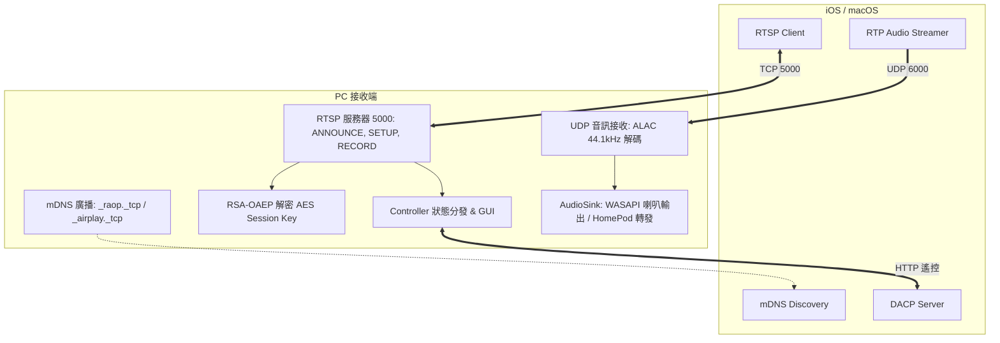
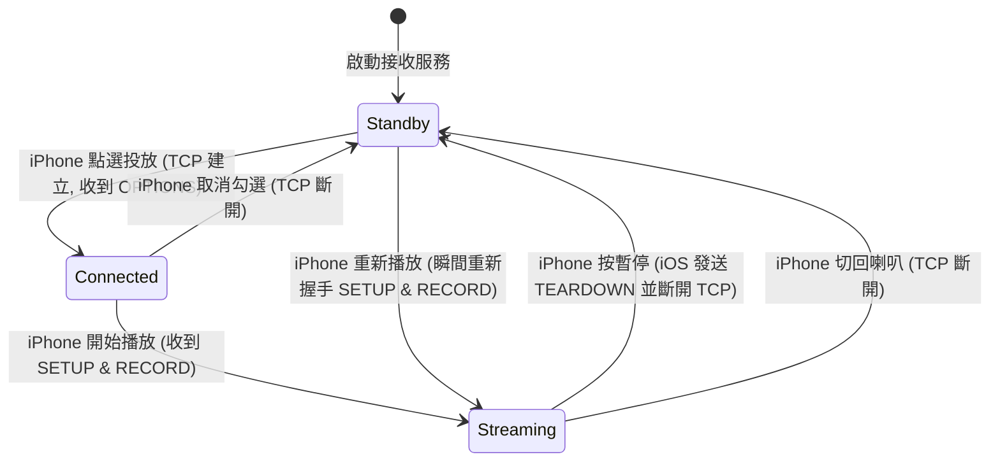

# AirPlay 音訊投放 (Audio Receiver) 架構設計與實務開發心得

本文件總結 Win2Pod Bridge 在研發「AirPlay 音訊投放（Audio Receiver）」功能過程中的核心架構決策、iOS 原生通訊協議分析、狀態機設計演進、音量同步避坑指南，以及 GUI 版面控制的最佳實踐。

---

## 目錄
1. [架構總覽與通訊機制](#1-架構總覽與通訊機制)
2. [狀態機設計哲學：真實通訊狀態 vs. 人為特例保持](#2-狀態機設計哲學真實通訊狀態-vs-人為特例保持)
3. [iOS 底層行為特性剖析](#3-ios-底層行為特性剖析)
4. [音量同步機制與狀態還原](#4-音量同步機制與狀態還原)
5. [UI 佈局與長文字防溢出最佳實踐](#5-ui-佈局與長文字防溢出最佳實踐)
6. [技術總結與未來展望](#6-技術總結與未來展望)

---

## 1. 架構總覽與通訊機制

Win2Pod Bridge 內建的純 Rust AirPlay 接收端（`airplay-receiver` crate）讓 Windows PC 能夠被 iOS / iPadOS / macOS 視為合法的 AirPlay 音訊設備。



### 關鍵模組職責
1. **mDNS 廣播與反向解析**：向區域網路發布 `_raop._tcp`（Remote Audio Output Protocol）與 `_airplay._tcp` 服務，同時反查發送端的 DACP 服務連接埠。
2. **RTSP 握手與安全憑證**：支援 Apple-Challenge / Apple-Response 認證，透過 RSA 私鑰解密 Session Key，並解析 SDP 與音訊參數。
3. **即時音訊管道**：使用獨立非同步任務監聽 UDP 6000（音訊資料）、UDP 6001（控制/重傳）、UDP 6002（時鐘校時），即時解密 ALAC 封包並送入低延遲環形緩衝區。
4. **雙向遠端控制（DACP）**：從 RTSP 標頭取得 `Active-Remote` 與 `DACP-ID`，透過 HTTP 介面向手機發送上一首、下一首、播放/暫停指令。

---

## 2. 狀態機設計哲學：真實通訊狀態 vs. 人為特例保持

在接收端狀態設計上，我們歷經了從「模擬暫停狀態」到「回歸純粹真實狀態」的演進。

### 階段一：嘗試人為模擬保持（踩坑期）
* **初始想法**：使用者在手機按暫停時，希望電腦介面能保留在「已連線」狀態，讓使用者可以在電腦上點擊播放按鈕繼續播放。
* **做法**：引入 30 秒寬限期（Grace Period）定時器，即使收到 RTSP `TEARDOWN` 或 TCP 關閉，依然將狀態維持在虛擬的 `Connected`。
* **產生的副作用**：
  1. **切回喇叭無法即時復原**：當使用者在 iPhone 上將音訊切回「iPhone 喇叭」，iOS 斷開 TCP 連線，但電腦端因寬限期仍在「已連線」，造成手機已斷開但電腦仍顯示連線的假象。
  2. **定時器與重連競態**：若使用者在第 29 秒重新播放，定時器與新連線事件容易交錯競爭，導致狀態紊亂甚至死鎖在錯誤狀態。
  3. **維護成本高昂**：引入了大量跨執行緒的心跳倒數與假狀態追蹤程式碼。

### 階段二：回歸真實通訊狀態（最佳實踐）
* **設計準則**：**「真實反映底層通訊狀態，絕不使用人為特例與定時器掩蓋底層事實。」**
* **重構後的清晰狀態機**：



* **優點**：
  * **零殘留、零副作用**：連線斷開即時退回待命，手機再次播放立即恢復播放中，完全符合原生 iOS 行為。
  * **架構極簡可靠**：徹底刪除所有假超時定時器，程式碼純粹由網路 Event-Driven 驅動。

### 階段三：智慧待命喚醒機制（體驗與狀態機的完美平衡）
* **挑戰**：回歸真實待命後，使用者若只是在手機上暫停片刻，看到播放按鈕消失會產生「無法在電腦上繼續播放」的困擾。
* **智慧解法（Proposal A）**：
  1. **底層忠實保持 Standby**：不維持假連線，TCP 該斷就斷，誠實反映底層通訊事實。
  2. **DACP 目標記憶快取（Session Target Caching）**：在 TCP 音訊連線斷開時，接收端依然安全保留最後一次連線的 iPhone IP、DACP 動態通訊埠與 `Active-Remote` 金鑰。
  3. **待命中保留 `▶` 按鈕與狀態反饋**：
     * **曾有連線（剛暫停不久）**：按鈕呈現青綠色，提示「點擊以嘗試喚醒手機繼續播放」。點擊時電腦主動連向 iPhone DACP 埠發送 `playpause`，iPhone 收到後在 0.2 秒內重新發起 RTSP 連線，瞬間切回「● 播放中」！
     * **喚醒超時（1.5 秒無響應，如手機已走遠或已切回喇叭）**：文字即時切換為溫和的橙黃色提示「⚠️ 無法喚醒手機，請至手機重新點選投放」（持續 3 秒後自動切回正常提示）。
     * **冷啟動（從未連線過）**：按鈕呈現柔和灰，點擊即時引導「📱 請先由手機控制中心點選投放至本裝置」。

---

## 3. iOS 底層行為特性剖析

開發過程中觀察並驗證的關鍵 iOS 原生 AirPlay 行為：

| iOS 操作動作 | iOS 原生通訊行為 | Win2Pod 對應狀態 | 備註 |
| :--- | :--- | :--- | :--- |
| **控制中心勾選投放** | 建立 TCP 連線，發送 `OPTIONS` | **● 已連線 (Connected)** | iOS 僅確認裝置在線，尚未配置 UDP 音訊通訊埠 |
| **點擊播放** | 發送 `ANNOUNCE`、`SETUP`、`RECORD` | **● 播放中 (Streaming)** | 配置音訊、控制、時間戳 UDP 埠，音訊串流正式開始 |
| **點擊暫停** | 發送 `TEARDOWN` 並立即**主動關閉 TCP Socket** | **○ 待命中 (Standby)** | iOS 不維持 idle 連線以節省電力，這是原生機制 |
| **暫停後點擊播放** | 重新連線 TCP，快速發送 ANNOUNCE/SETUP/RECORD | **● 播放中 (Streaming)** | 重新握手耗時 < 100ms，使用者體驗幾乎無縫 |
| **切換回 iPhone 喇叭** | 主動關閉 TCP Socket (FIN / RST) | **○ 待命中 (Standby)** | EOF 讀取瞬間觸發 `ClientDisconnected` |

> [!IMPORTANT]
> iOS 在暫停時會關閉唯一連線。因此，將斷線直接對應為「待命」，是最符合底層通訊事實的做法，切勿試圖在單一 TCP 連線關閉後維持假連線。

---

## 4. 音量同步機制與狀態還原

### 問題現象
當手機暫停後再次點擊播放時，接收端卡在 `手機端音量: --`，直到使用者手動撥動手機側邊音量鍵才恢復顯示數字。

### 根因分析
1. 斷線回歸待命時，控制器將 `airplay_receiver_volume` 重設為 `None`。
2. iPhone 重新連線開播時，iOS 預設**不會**重新主動送出 `SET_PARAMETER volume`，只會在開播前保留原有音量。
3. 如果沒有主動機制觸發音量回報，GUI 的狀態欄位將持續維持為未初始化的 `None`。

### 解決方案
1. **本機記憶體繼承**：在控制器層維護 `last_known_phone_volume: Option<u8>`，記憶該裝置最後一次確認的有效音量。
2. **RECORD 階段主動回報**：
   在 `rtsp.rs` 處理 `RECORD` 要求時，取得 Session 中當前的 `volume_db`，主動呼叫一次 `sink.on_volume_change(cur_volume)`。
3. **連線還原**：在收到 `ClientConnected` 或 `StreamingStatus { streaming: true }` 時，若當前音量為 `None`，立即無縫套用 `last_known_phone_volume`。
4. **移除誤導按鈕**：移除 `[🔊 設為最大]` 按鈕，僅呈現單純真實的音量數字，避免與 iOS 端衝突。

### DACP 遠端控制 `setproperty` 與 iPhone 動態埠避坑指南
在 iOS 的 DACP (Digital Audio Control Protocol) 實作中，有三個極易踩雷的關鍵技術點：

1. **AirPlay 端點音量屬性為 `dmcp.device-volume` 且數值為分貝 (dB) 浮點數**：
   * **屬性名稱**：傳統 iTunes 電腦庫主音量使用 `dmcp.volume`（0~100），但 AirPlay 投放端點裝置的音量屬性必須是 **`dmcp.device-volume`**。
   * **數值格式**：以衰減分貝（dB）浮點數表示（保留 6 位小數），**100% 最大音量為 `0.000000` dB**（無衰減），最低音量為 `-30.000000` dB（靜音為 `-144.000000`）。傳入整數如 `100` 會被 iOS 解釋器直接報錯拒絕。
   * **認證方式**：AirPlay RAOP 的反向遙控在連線建立時透過 HTTP 標頭 `Active-Remote: <ID>` 驗證即可，**不可隨意附帶 `&session-id=1`**（在未先進行 DACP `login` 流程下，無效的 session-id 會直接觸發 iOS 回傳 `HTTP/1.1 400 Bad Request`）。
   * **正確寫法**：
     ```http
     GET /ctrl-int/1/setproperty?dmcp.device-volume=0.000000 HTTP/1.1
     Host: <IP>:<DYNAMIC_PORT>
     Active-Remote: <ACTIVE_REMOTE>
     Connection: close
     ```

2. **iPhone 監聽埠為隨機動態埠（絕非固定 3689）**：
   * **常見誤區**：傳統電腦版 iTunes / DAAP 伺服器預設為 `3689`，但 iPhone 作為發送端時，每次連線都是臨時在背景隨機綁定高位動態通訊埠（Ephemeral Port，如 `49152`~`65535`）。
   * **尋找真實 Port 的流程**：
     * 從 RTSP 握手標頭擷取 `DACP-ID`。
     * 透過 mDNS 廣播查詢 `_dacp._tcp.local.` 服務，搜尋名稱為 `iTunes_Ctrl_<DACP-ID>` 的項目。
     * 解析該服務的 SRV 記錄取得真實的動態 Port（例如 `54321`）。
     * 將 HTTP 請求精準送往 `http://<IP>:<DYNAMIC_PORT>/ctrl-int/1/...`。若退回 3689 則 100% 被拒絕或超時。

3. **iOS 控制中心音量拉桿的單向保護機制與接收端「固定滿格數位直通」解法**：
   * **現象**：向 iPhone 發出 `setproperty?dmcp.device-volume=0.000000` 後，iPhone 的 DACP 伺服器會立即回傳 `HTTP/1.1 200 OK`，但 iPhone 螢幕上的控制中心音量拉桿並不會移動。
   * **協定限制**：iOS 內部機制禁止外部接收端反向強制竄改手機實體音量與畫面拉桿。
   * **音響工程標準解法**：
     * 在音訊解碼階段（`rtp.rs`），開啟 `ignore_volume_control` 模式。
     * 解碼 ALAC/PCM 時，強制將乘數錨定為 `1.0`（0 dB，Unity Gain），完全不對取樣點做衰減處理。
     * 此做法與高級音響 DAC / Shairport Sync 的 `ignore_volume_control` 完全一致，既保證了滿格無損數位輸出，又免除了使用者在手機上反覆調整音量的麻煩。

4. **移除冗餘網路呼叫與死代碼（Dead Code Elimination）**：
   * 既然確認 iOS 控制中心不接受接收端反向調整音量，先前在開播（`RECORD`）與解析名稱階段嘗試發送的 `rx.send_dacp(SetVolume(100))` 實屬徒勞，且每次切歌或連線都會引發額外的 HTTP Socket 握手開銷與日誌報錯。
   * **重構成果**：全面移除 DACP `SetVolume` 呼叫、相關死指令 `GuiCmd::AirPlayReceiverDacpSetVolume`，回歸純粹的「本地 PCM 解碼直通」架構，讓網路層只專注於播放/暫停/跳曲的控制，降低網路雜訊。

---

## 5. UI 佈局與長文字防溢出最佳實踐

在 egui 實作精緻且緊湊的媒體卡片時，長字串（如現場演唱會曲名、長專輯名）很容易引發版面走樣。

### 1. 雙重截斷防線
若曲名或藝人文字過長，直接在 `ui.horizontal` 中排版會撐開整行寬度，將右側的狀態徽標（`● 播放中`）推到視窗邊界外。
* **第一道防線（字串層）**：歌手名與專輯名在拼接前各自獨立截斷至 12~14 字元，歌名截斷至 22 字元。
* **第二道防線（Widget 層）**：使用 `egui::Label::new(...).truncate()`，使溢出文字自動替換為 `...`，避免物理撐寬容器。

### 2. 版面約束與空白行排查（重大踩坑紀錄）
* **問題**：為了限制中間文字寬度，使用了 `allocate_ui_with_layout(vec2(w, 0.0), ...)`，卻導致曲名上方平白出現一行空白。
* **排查根因**：
  在 `ui.horizontal`（預設交叉軸垂直居中 `Align::Center`）內，`allocate_ui_with_layout` 分配了一個高度為 0 的矩形，egui 將該矩形與左側 36px 封面垂直置中，導致矩形起點被下移了 18px，造成內部第一行文字向下位移！
* **正確做法**：
  使用標準的 `ui.vertical` 搭配 `ui.set_max_width`：
  ```rust
  let total_avail = ui.available_width();
  let badge_w = badge_galley.size().x + 8.0;
  let middle_w = (total_avail - badge_w - ui.spacing().item_spacing.x).max(60.0);

  // 正確做法：頂部齊平，且嚴格約束最大寬度
  ui.vertical(|ui| {
      ui.set_max_width(middle_w);
      // 文字與控制按鈕排版...
  });

  // 右側狀態徽標永遠保留足夠空間，絕對不溢出視窗
  ui.with_layout(egui::Layout::right_to_left(egui::Align::Center), |ui| {
      ui.label(RichText::new(badge_text).color(badge_color));
  });
  ```

### 3. 多國語言長度防禦：狀態分離與懸停提示（Tooltip）架構
* **問題背景**：原本設計試圖將所有資訊擠在按鈕旁的單一橫行，顯示如 `手機端音量: 33% (以最大動態範圍播出中)`。在翻譯成德文、法文、俄文時，長度飆升至 50~75 字元（例如俄語 `Громкость: 33% (воспроизведение с макс. динамическим диапазоном)`），在 150px 的剩餘空間中造成嚴重文字溢出與破版。
* **認知與版面雙重解法**：
  1. **認知一致性（去除矛盾資訊）**：在直通模式下，PCM 滿格輸出，手機音量已無實質作用，同時展示「33%」與「最大動態」只會引發使用者對實際音量的困惑。
  2. **簡練標籤化**：在直通模式下隱藏音量百分比，直接顯示短小精緻的 `✨ 最大動態範圍`（各國語言均控制在 12~20 字元內，空間節省 65% 以上）。
  3. **次級資訊移入 Hover Tooltip**：完整原理解釋與手機實際音量（如 `以 100% 原始最大動態範圍播出中（已忽略手機端音量減損，當前手機音量為 33%）`）移至滑鼠懸停提示，既保證版面清爽，又兼顧極致透明的資訊完整度。

---

## 6. 技術總結與未來展望

1. **架構簡潔性勝過複雜補丁**：當底層協議（如 iOS RTSP）有其固定行為時，嘗試在應用層加入「假超時」往往會帶來更多邊界問題（如切換喇叭不同步）。順應協議真實狀態，系統才能具備最高穩定性。
2. **狀態記憶勝過重複索取**：面對客戶端在重連時「沈默不發」的數據（如音量），伺服端適度保留上次有效狀態並在重播時及時補發，是保證 UI 流暢與直覺的關鍵。
3. **GUI 彈性約束防禦**：桌面工具在固定或自適應視窗寬度下，任何外部來源字串（歌曲名、設備名）都必須視為潛在的不定長度威脅，嚴格進行雙重截斷與寬度邊界鎖定。

---

## 7. 開源致謝與授權 (Open Source Credits & Licenses)

本專案之音訊接收端與反向遙控實現，深受開源社群啟發並致謝：
* [**UxPlay**](https://github.com/FDH2/UxPlay) (antimof / FDH2, GPL-3.0)：AirPlay RAOP / RTSP 伺服器協議解析、DACP 雙向遠端控制架構與鏡像通訊參考。
* [**airplay2-rs**](https://github.com/lmcgartland/airplay2-rs) (Lucas McGartland, GPL-3.0-or-later)：AirPlay 2 協定引擎、PTP/NTP 時鐘同步與串流管線核心。
* [**windows-airplay-homepod**](https://github.com/iakacer/windows-airplay-homepod) (Yang Liu / iakacer, GPL-2.0)：Windows AirPlay 串流原型與 HomePod 輸出參考。
* [**AirPodsDesktop**](https://github.com/SpriteOvO/AirPodsDesktop) (SpriteOvO, GPL-3.0)：Apple Continuity BLE 廣播協定逆向工程與入耳偵測實作。

