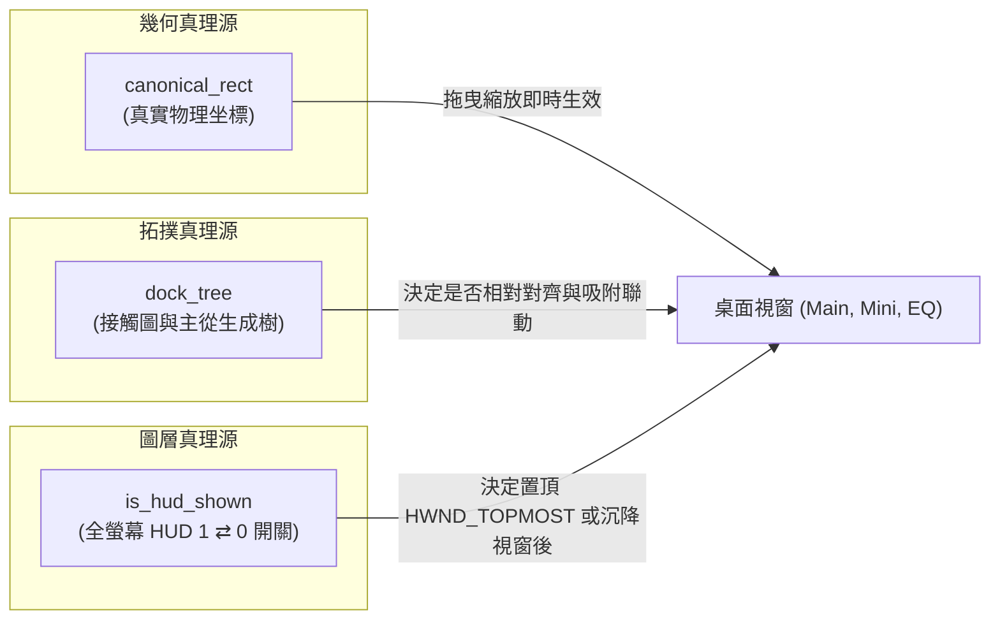

# Win2Pod 全螢幕 HUD 生命週期重構與 Prior State 消滅心法
# (Fullscreen HUD Lifecycle & Prior State Elimination Insights)

> **核心摘要**：本文深度總結 Win2Pod 在多視窗模組化工作站（Main, Mini, EQ, Visualizer）進入全螢幕 HUD 懸浮層時，由「快照沙盒假設（Snapshot Sandbox Fallacy）」引發的視窗循環閃現與座標倒退缺陷，剖析為何狀態機中的 `prior_state` 與 `FullscreenHud` 實為架構定時炸彈，並闡述如何透過「三維單一真實來源（Single Source of Truth, SSOT）」達成純粹、優雅且不可動搖的視窗管理系統。

---

## 一、 問題背景與現象剖析 (Symptoms & Context)

在 Win2Pod 的視覺效果視窗（Visualizer，WebView2 驅動的 3D 粒子頻譜球）進入全螢幕後，使用者可點擊視覺視窗角落的 🏠（Home / 房子按鈕）呼叫桌面其他音訊視窗（主視窗、迷你播放器、等化器）作為 HUD 懸浮層浮現於全螢幕之上，方便進行調音與歌曲切換。

然而，在重構前陸續暴露了兩個嚴重的反常現象：

### 現象 1：2 視窗 ⇄ 3 視窗死循環震盪
* **使用者操作**：工作站群組吸附狀態下，進入全螢幕，點擊 🏠，三個視窗閃現後只留下迷你播放器；再點 🏠，出現主視窗+迷你播放器；再點 🏠，出現三個視窗；以此不斷規律震盪循環，且永遠無法完全隱藏 HUD。
* **深層原因**：
  1. 舊的 `exit_hud()` 呼叫了封裝於 `ManagedWindow` 內的 `apply_geometry(*rect, false)`。
  2. `apply_geometry` 底層無條件帶有 Win32 `SWP_SHOWWINDOW` 標誌。
  3. 這導致收起 HUD 時非但沒有隱藏視窗，反而在 `activate: true` 與 `activate: false` 之間規律震盪，觸發 Z-order 爭搶死循環。

### 現象 2：全螢幕 HUD 下移動視窗，退出全螢幕後瞬間倒退回原地
* **使用者操作**：四個視窗拆開獨立浮動，視覺視窗進入全螢幕，按 🏠 呼叫 HUD（三個視窗原地浮現），使用者手動將其中一個視窗（如 MiniPlayer）拖曳至新的螢幕位置；接著退出全螢幕，被移動的視窗竟然**瞬間跳回拖曳前的舊原地**！
* **深層原因**：
  1. 狀態機將視窗狀態標記為 `WindowLifecycleState::FullscreenHud { prior_state: Box<WindowLifecycleState>, hud_rect }`。
  2. 視窗拖曳時的 `on_user_move` 僅更新了外部矩形，根本沒有穿透更新 `prior_state`。
  3. 當視覺視窗退出全螢幕時，系統執行 `exit_hud()`，從 `prior_state` 中取出進入全螢幕前的舊座標，呼叫 Win32 `SetWindowPos` 強行覆蓋了使用者的手動位移！

```mermaid
flowchart TD
    subgraph 舊架構的錯誤假設：快照沙盒反模式 (Snapshot Sandbox Anti-Pattern)
        A[進入全螢幕 HUD] --> B[建立 prior_state 快照備份進入前座標]
        B --> C[使用者在全螢幕下拖曳/縮放視窗]
        C --> D[prior_state 殘留舊座標未同步]
        D --> E[退出全螢幕 exit_hud]
        E --> F[讀取 prior_state 舊座標]
        F --> G[apply_geometry 呼叫 SetWindowPos 強制覆蓋]
        G --> H[視窗倒退回幾分鐘前的舊原地！]
    end
```

---

## 二、 架構深思：為什麼 `prior_state` 必須徹底消滅？

當排查出上述問題時，我們曾嘗試在 `on_user_move` 與 `on_user_resize` 內部增加 `match prior_state.as_mut()` 穿透更新舊座標。但隨即使用者提出了一個極具洞察力的質問：

> **「像回復進入全螢幕前的視窗狀態，反而會讓使用者困惑。`prior_state` 還有存在的必要？」**

這句話直指軟體架構的核心——**`prior_state` 是基於一個根本錯誤的設計假定而存在的歷史包袱**。

### 1. 錯誤假設：HUD 是暫時性的沙盒
原設計認為進入 HUD 就像彈出一個模態對話框（Modal Dialog），退出時應該「假裝一切都沒發生過」還原回進入前的一切狀態。

### 2. 殘酷現實：使用者在 HUD 內的操作全部都是「真實的」
在真實人機互動中：
* 使用者在全螢幕下把視窗拉開，他是**真的要拆開它**。
* 使用者在全螢幕下把視窗移到右下角，那是他**期望它現在與未來停留的位置**。
* 使用者把等化器點 X 關閉，他是**真的想關閉它**。

**「沒有任何一個使用者會期望自己花了力氣排版好的視窗，在退回桌面時突然被系統粗暴地搬回原地。」**

### 3. `prior_state` 帶來的四大工程負債
1. **座標倒退定時炸彈**：一旦有任何拖曳或動畫路徑未同步更新到 `prior_state`，退回桌面時必定產生座標瞬移。
2. **拓撲狀態自相矛盾**：若使用者在全螢幕下拆開吸附群組，底層圖論 `dock_tree` 已經將視窗切換為獨立個體（`is_bonded = false`），但 `prior_state` 依然記憶著 `WorkstationDocked { root: Main, .. }`，造成退出全螢幕時邏輯分裂。
3. **冗餘同步開銷與心智負擔**：每一次幾何異動都必須層層拆解 `Box<WindowLifecycleState>` 進行滲透更新。
4. **堆積記憶體分配（Heap Allocation）**：為了在 Enum 內進行遞迴自我引用，不可避免地使用了 `Box<T>`，增加了動態記憶體配置與深度拷貝代價。

---

## 三、 重構後架構：三維單一真理源 (Single Source of Truth, SSOT)

徹底消滅 `prior_state` 與 `FullscreenHud` 後，系統不再需要任何「狀態備份」與「狀態還原」，而是由三個獨立、正交的真實來源共同驅動：



### 1. 幾何真理源：`canonical_rect`
* **原則**：視窗當前在螢幕上的位置就是唯一的真理。
* 拖曳完成（`WM_EXITSIZEMOVE`）即時更新 `canonical_rect` 與 `Floating { rect }` / `WorkstationDocked { rect, .. }`。
* **絕不呼叫任何搬移 API 去試圖恢復過去的位置**。

### 2. 拓撲真理源：`dock_tree`
* **原則**：視窗是獨立浮動還是吸附在工作站上，完全由幾何接觸與有向無環樹（DAG）決定。
* 不論是在桌面還是在全螢幕 HUD 下，只要拉開距離超出磁吸閾值（16px），立即 sever edge，視窗自主成為獨立根節點。

### 3. 圖層真理源：`is_hud_shown`
* **原則**：HUD 本質上只是**全螢幕視覺特效圖層的置頂與沉降管理**，完全不干涉視窗的內在生命週期。
* 視窗在 HUD 期間，它依然是正常的 `Floating` 或 `WorkstationDocked` 視窗，不需要產生「身分認同危機」去變成 `FullscreenHud`。

---

## 四、 全域五大不變量規則 (The 5 Universal Invariants)

以此架構為基石，Win2Pod 確立了視窗與全螢幕 HUD 的五大不可動搖規則：

| 規則名稱 | 核心原則 | 實踐細節 |
| :--- | :--- | :--- |
| **1. 幾何永恆性<br/>(Geometry Permanence)** | 操作即真實，絕不倒退 | 拖曳縮放即刻寫入 `canonical_rect`。退出全螢幕時只還原視覺視窗樣式，**絕不搬移任何其他視窗**。 |
| **2. 自主權尊重<br/>(Iconic Shielding)** | 最小化就是最小化 | 使用者最小化到工作列的視窗，退出全螢幕或開關 HUD 時**絕對保持最小化**，嚴禁擅自彈出或復原。 |
| **3. 存活者動態過濾<br/>(Dynamic Targeting)** | 絕不召喚已關閉視窗 | `get_all_hud_target_windows()` 動態掃描存活視窗。若在全螢幕下點 X 關閉等化器，下次按 🏠 絕不詐屍彈出。 |
| **4. 焦點絕對穩定<br/>(Focus Stability)** | 全螢幕保持控制權 | HUD 喚起時採用 `SWP_NOACTIVATE \| HWND_TOPMOST` 單發置頂。鍵盤焦點永遠鎖定在視覺視窗，按 🏠 展開、再按 🏠 瞬間收起。 |
| **5. 乾淨二元開關<br/>(Single-Shot Binary Toggle)** | 嚴格 `1 ⇄ 0 ⇄ 1 ⇄ 0` | 廢除所有多分支狀態切換，收起 HUD 統一沉降至全螢幕視覺視窗背後（`SetWindowPos(h, vis_hwnd, ...)`），杜絕死循環震盪。 |

---

## 五、 重構前後程式碼對比 (Code Evolution)

### 1. `WindowLifecycleState` 的淨化
* **重構前（包含堆積遞迴、繁瑣脆弱）**：
  ```rust
  pub enum WindowLifecycleState {
      Uninitialized,
      Floating { rect: WindowRect },
      WorkstationDocked { root: WindowKind, rect: WindowRect },
      Minimized { target: MinimizeTarget, restore_rect: WindowRect },
      Fullscreen { pre_fs_rect: WindowRect },
      // ❌ 歷史包袱：自我引用備份，引發無限災難
      FullscreenHud {
          prior_state: Box<WindowLifecycleState>,
          hud_rect: WindowRect,
      },
      HiddenToTray { restore_rect: WindowRect },
  }
  ```
* **重構後（扁平、零 Heap Allocation、純粹直觀）**：
  ```rust
  pub enum WindowLifecycleState {
      Uninitialized,
      Floating { rect: WindowRect },
      WorkstationDocked { root: WindowKind, rect: WindowRect },
      Minimized { target: MinimizeTarget, restore_rect: WindowRect },
      Fullscreen { pre_fs_rect: WindowRect },
      HiddenToTray { restore_rect: WindowRect },
  }
  ```

### 2. 視窗移動與縮放回呼的簡化
* **重構前**：
  ```rust
  match &mut self.state {
      WindowLifecycleState::Floating { rect } => *rect = safe,
      WindowLifecycleState::WorkstationDocked { rect, .. } => *rect = safe,
      // ❌ 必須小心翼翼層層拆解備份狀態
      WindowLifecycleState::FullscreenHud { prior_state, hud_rect } => {
          *hud_rect = safe;
          match prior_state.as_mut() {
              WindowLifecycleState::Floating { rect } => *rect = safe,
              WindowLifecycleState::WorkstationDocked { rect, .. } => *rect = safe,
              _ => {}
          }
      }
      _ => {}
  }
  ```
* **重構後**：
  ```rust
  // ✅ 直觀更新真實狀態，無多餘包贅
  match &mut self.state {
      WindowLifecycleState::Floating { rect } => *rect = safe,
      WindowLifecycleState::WorkstationDocked { rect, .. } => *rect = safe,
      _ => {}
  }
  ```

### 3. 退出全螢幕邏輯的徹底解耦
* **重構前**：
  ```rust
  // ❌ 退出全螢幕擅自去干涉、還原甚至搬移其他視窗
  for k in [WindowKind::Main, WindowKind::MiniPlayer, WindowKind::Equalizer] {
      if let Some(w) = self.windows.get_mut(&k) {
          if w.state.is_hud() {
              w.exit_hud(); // 內部引發 apply_geometry 搬移舊座標！
          }
      }
  }
  ```
* **重構後**：
  ```rust
  // ✅ 視覺視窗退出全螢幕，純粹只管自己的幾何與樣式；其餘視窗紋絲不動！
  if let Some(vis) = self.windows.get_mut(&WindowKind::Visualizer) {
      vis.exit_fullscreen();
  }
  ```

---

## 六、 測試驗證與工程收穫 (Verification & Metrics)

在全新的架構下，我們為視窗生命週期與 HUD 交互編寫了嚴密的自動化測試鏈：
1. **`test_hud_binary_toggle_lifecycle`**：連續四次觸發 🏠 開關，驗證釘選圖層在 `1 ⇄ 0 ⇄ 1 ⇄ 0` 嚴格翻轉，絕無震盪死循環。
2. **`test_hud_window_move_preserved_across_fullscreen_exit`**：模擬四視窗拆開、全螢幕、喚起 HUD、拖曳移動視窗、退出全螢幕全流程，斷言視窗精準停留在最新座標（`left: 800, top: 200, bottom: 500`），未發生任何座標回彈。
3. **全域測試矩陣**：`cargo test -p homepod-cast-gui` 全部 78 個單元測試 100% 通過，0 Warnings。

---

## 七、 結語 (Conclusion)

軟體工程中許多複雜難解的 Bug，往往不是因為程式碼寫得不夠周全，而是**一開始的抽象概念建立在錯誤的假設上**。

將全螢幕 HUD 當成「沙盒」並引入 `prior_state`，是試圖用更多狀態補丁去掩蓋假定缺陷的典型案例。感謝使用者的及時提醒，透過斷然剔除 `prior_state`、回歸「三維單一真理源」，我們不僅根除了兩個嚴重的 UI 缺陷，更刪除了近百行脆弱的遞迴邏輯，使 Win2Pod 的視窗子系統達到了空前的堅固與優雅。
