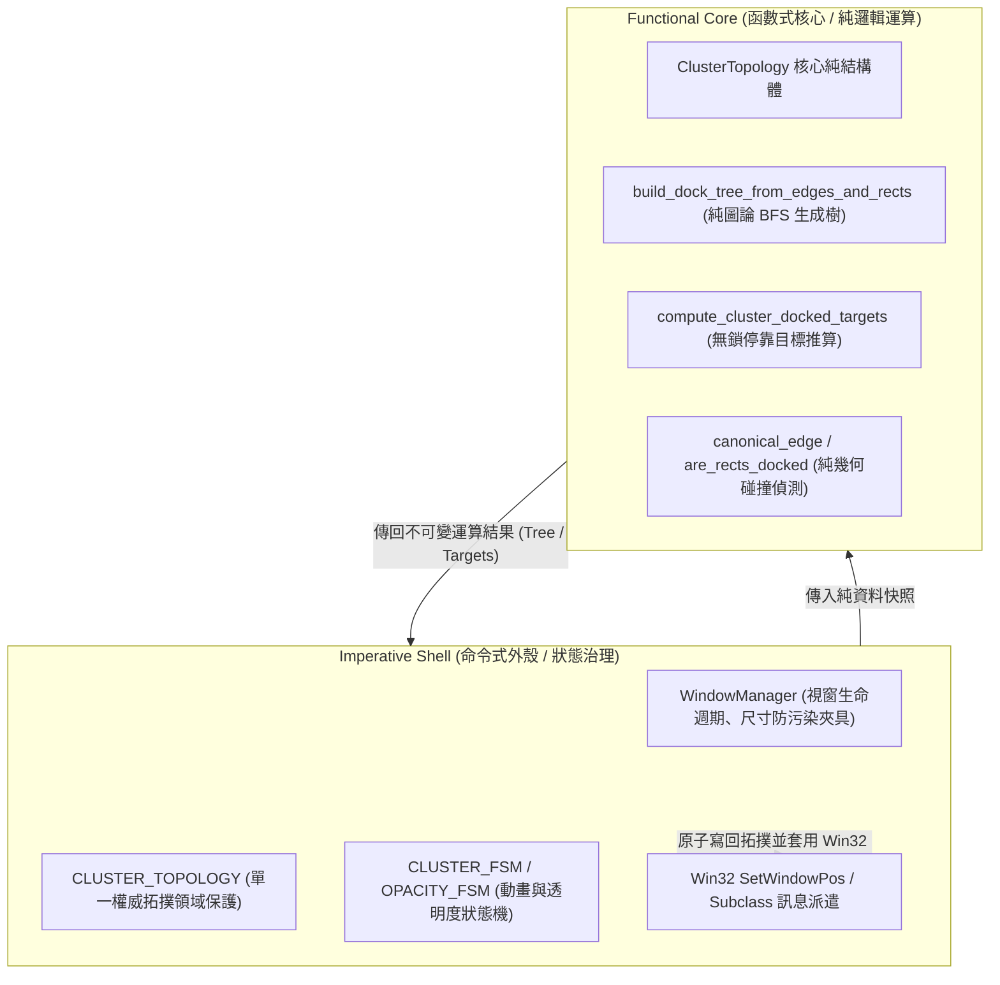

# Win2Pod 視窗吸附純邏輯拓撲與靜態鎖消除架構實踐
# (Snapping Pure Topology & Lock Centralization Architecture Insights)

## 1. 概述與架構演進背景

在 Win2Pod 多視窗磁吸吸附（Magnetic Snapping）的初期實作中，多視窗之間的力學關聯與記憶幾何散落在多個全域 `lazy_static` / `Mutex` 變數中，例如：
* `DOCK_EDGES: Mutex<Option<HashSet<(WindowKind, WindowKind)>>>`
* `DOCK_TREE: Mutex<Option<HashMap<WindowKind, DockBond>>>`
* `LAST_KNOWN_RECTS: Mutex<Option<HashMap<WindowKind, RECT>>>`

這種「邊計算幾何、邊存取全域鎖、邊調用 Win32 API」的緊密耦合模式，帶來了以下嚴重的架構缺陷：
1. **狀態所有權碎裂（State Fragmentation）**：吸附邊、生成樹與快取矩形缺乏原子同步保證，存在邊被更新但樹未重新計算的中間破綻。
2. **演算法純度不足**：計算「視窗該停靠何處」需要真實 Win32 HWND 與全域鎖上下文，無法獨立進行離線純邏輯單元測試。
3. **並行鎖死風險（Deadlock Vulnerability）**：不同執行緒（Win32 WndProc、UI 繪圖執行緒、動畫定時器）以不同順序請求鎖時，容易引發經典死鎖。

為了徹底解決此問題，我們對系統實施了兩項緊密關聯的架構演進：**「吸附邏輯走向純邏輯資料結構」** 與 **「狀態集中化與消除散落全域鎖」**。

---

## 2. 核心架構辨析：兩種重構的維度與邊界

這兩項概念常被並列討論，但本質上屬於不同的工程層次：



| 比較維度 | 1. 狀態集中化與消除散落全域鎖 | 2. 吸附邏輯走向純邏輯資料結構 |
| :--- | :--- | :--- |
| **關注維度** | **系統架構 / 狀態所有權治理（State Ownership & Lifecycle）** | **運算模型 / 領域演算法解耦（Computational Model & Purity）** |
| **對應模式** | **Imperative Shell（命令式外殼）** | **Functional Core（函數式核心）** |
| **解決的核心痛點** | 多個散落的 `static Mutex<T>` 導致鎖順序倒置、狀態碎片化與競態。 | 吸附演算法邊算邊讀取鎖或呼叫 Win32 API，具有副作用且難以測試。 |
| **在 Win2Pod 的具體實作** | 將 3 個散落的鎖銷毀，收斂至單一權威的 `ClusterTopology` 領域，嚴格劃分動畫與感知狀態機。 | 抽離出 `ClusterTopology` 結構體，所有方法只操作記憶體中的資料，**0 個 Win32 呼叫、0 個 Mutex 鎖**。 |
| **單元測試性** | 測試狀態機在各生命週期切換時的合法性。 | **100% 確定性離線純幾何測試**（73 項單元測試可在 0.70 秒內極速完成）。 |

---

## 3. 純邏輯資料結構設計：`ClusterTopology`

在 `crates/homepod-cast-gui/src/snapping/cluster.rs` 中，我們定義了純粹的拓撲模型：

```rust
/// Pure Logical Data Structure for multi-window snapping topology and dock tree hierarchy.
/// Contains no Win32 calls, no Mutex locks inside, and is 100% deterministically unit-testable.
#[derive(Clone, Default)]
pub struct ClusterTopology {
    pub edges: HashSet<(WindowKind, WindowKind)>,
    pub tree: HashMap<WindowKind, DockBond>,
    pub known_rects: HashMap<WindowKind, RECT>,
}

impl ClusterTopology {
    pub fn new() -> Self {
        Self::default()
    }

    pub fn add_edge(&mut self, a: WindowKind, b: WindowKind) {
        self.edges.insert(canonical_edge(a, b));
    }

    pub fn remove_edge(&mut self, a: WindowKind, b: WindowKind) {
        self.edges.remove(&canonical_edge(a, b));
    }

    pub fn remove_all_edges_for(&mut self, kind: WindowKind) {
        self.edges.retain(|&(a, b)| a != kind && b != kind);
    }

    pub fn update_known_rect(&mut self, kind: WindowKind, rect: RECT) {
        self.known_rects.insert(kind, rect);
    }

    pub fn get_known_rect(&self, kind: WindowKind) -> Option<RECT> {
        self.known_rects.get(&kind).copied()
    }

    pub fn clear_known_rects(&mut self) {
        self.known_rects.clear();
    }

    pub fn is_in_cluster(&self, kind: WindowKind) -> bool {
        self.edges.iter().any(|&(a, b)| a == kind || b == kind)
    }

    pub fn get_cluster_members(&self, kind: WindowKind) -> Vec<WindowKind> {
        let mut members = HashSet::new();
        let mut queue = VecDeque::new();
        members.insert(kind);
        queue.push_back(kind);
        while let Some(curr) = queue.pop_front() {
            for &(a, b) in &self.edges {
                let neighbor = if a == curr {
                    Some(b)
                } else if b == curr {
                    Some(a)
                } else {
                    None
                };
                if let Some(n) = neighbor {
                    if members.insert(n) {
                        queue.push_back(n);
                    }
                }
            }
        }
        let mut list: Vec<_> = members.into_iter().collect();
        list.sort_by_key(|k| k.priority());
        list
    }

    pub fn get_root(&self, kind: WindowKind) -> WindowKind {
        let members = self.get_cluster_members(kind);
        members.into_iter().min_by_key(|k| k.priority()).unwrap_or(kind)
    }

    pub fn get_role(&self, kind: WindowKind) -> WindowRole {
        if !self.is_in_cluster(kind) {
            return WindowRole::Standalone;
        }
        if self.get_root(kind) == kind {
            WindowRole::ClusterMaster
        } else {
            WindowRole::ClusterSlave
        }
    }

    pub fn get_component_root(&self, kind: WindowKind) -> WindowKind {
        let mut curr = kind;
        let mut visited = HashSet::new();
        while let Some(bond) = self.tree.get(&curr) {
            if !bond.is_bonded || visited.contains(&curr) {
                break;
            }
            visited.insert(curr);
            curr = bond.parent;
        }
        curr
    }

    pub fn build_tree(
        &mut self,
        active_windows: &[WindowKind],
        get_rect: impl Fn(WindowKind) -> Option<RECT>,
    ) {
        let edge_slice: Vec<(WindowKind, WindowKind)> = self.edges.iter().copied().collect();
        self.tree = build_dock_tree_from_edges_and_rects(active_windows, &edge_slice, get_rect);
    }
}
```

### 優勢
1. **無鎖運算（Lock-free In-Memory Compute）**：整個演算法運作期間完全不請求作業系統同步原語。
2. **強自洽性（Cohesion）**：接觸邊（`edges`）、生成樹（`tree`）與記憶矩形（`known_rects`）在同一個邏輯結構中受保護，避免樹與邊不同步的裂腦（Split-Brain）現象。

---

## 4. 重入死鎖深度排查與快照式計算模式 (The Re-entrant Deadlock Trap)

### 4.1 踩坑現場：單元測試卡住 14 分鐘
在將多個靜態鎖初步整合為單一互斥鎖時，執行 `cargo test` 發生測試長時間未完成，檢查日誌發現：
```text
test snapping::tests::test_compute_cluster_docked_targets has been running for over 60 seconds...
Last progress: 14m4s ago
```

### 4.2 根因剖析：非重入鎖與閉包巢狀呼叫
Rust 原生 `std::sync::Mutex` 是 **非重入的（Non-reentrant）**。當同一個執行緒已經持有某個 Mutex 時，如果呼叫鏈下游的函式再次嘗試獲取該 Mutex，該執行緒將會**自我死鎖（Self-Deadlock）**。

在重構前的程式碼中，`compute_cluster_docked_targets` 採用了長生命週期的鎖持有寫法：
```rust
// ❌ 易死鎖反模式：長生命週期閉包鎖
pub fn compute_cluster_docked_targets(root: WindowKind, root_rect: &RECT) -> HashMap<WindowKind, RECT> {
    // ...
    with_dock_tree(|tree| { // ⚠️ 持有拓撲鎖
        while let Some(parent) = queue.pop_front() {
            for (&child, bond) in tree.iter() {
                // ⚠️ 呼叫 get_window_normal_rect，在測試環境或離屏環境中，
                // 該函式內部再次呼叫了 get_known_rect(child) -> 試圖獲取同一個拓撲鎖！
                let normal_r = unsafe { get_window_normal_rect(child) };
                // ...
            }
        }
    });
}
```
類似問題也存在於 `rebuild_dock_tree` 中：在 `with_dock_edges(|edges| { ... })` 的過濾閉包內，呼叫了 `is_in_collapsed_or_anim`，其內部調用了 `get_component_root`（再次請求拓撲鎖），引發同一執行緒二次取鎖而永久卡死。

### 4.3 終極解法：快照式無鎖計算模式（Copy-on-Write Snapshot Pattern）

為根除任何可能的重入死鎖，我們實施了**「極短臨界區快照模式」**：
1. **極速快照**：只在讀取或寫入狀態時進入臨界區，耗時 $< 1\mu\text{s}$，完成後立刻釋放鎖。
2. **純無鎖運算**：所有耗時的圖走訪、坐標推導與幾何計算皆在本地快照變數上執行，期間可安全呼叫任何子系統。
3. **無鎖寫回**：計算完成後，若有需要再以最小臨界區寫回結果。

```rust
// ✅ 安全現代化模式：快照式無鎖計算
pub fn compute_cluster_docked_targets(
    root: WindowKind,
    root_rect: &RECT,
) -> HashMap<WindowKind, RECT> {
    let mut targets = HashMap::new();
    targets.insert(root, *root_rect);

    // 1. 取得樹快照並【立即釋放鎖】
    let tree = with_dock_tree(|t| t.clone());

    let mut queue = VecDeque::new();
    queue.push_back(root);

    // 2. 全程無鎖計算
    while let Some(parent) = queue.pop_front() {
        let parent_rect = match targets.get(&parent).copied() {
            Some(r) => r,
            None => continue,
        };

        for (&child, bond) in tree.iter() {
            if bond.is_bonded && bond.parent == parent && !targets.contains_key(&child) {
                // 此處即使 get_window_normal_rect 內部存取拓撲快取，亦絕不發生死鎖！
                let normal_r = unsafe { get_window_normal_rect(child) };
                let raw_w = normal_r.right - normal_r.left;
                let raw_h = normal_r.bottom - normal_r.top;
                let (def_w, def_h) = {
                    let s = child.default_size();
                    (s[0] as i32, s[1] as i32)
                };
                let w = if raw_w > 50 { raw_w } else { def_w };
                let h = if raw_h > 50 { raw_h } else { def_h };

                let child_dummy_rect = RECT { left: 0, top: 0, right: w, bottom: h };
                let (x, y) = calc_bonded_visualizer_pos(bond, &child_dummy_rect, &parent_rect);
                let child_target_rect = RECT { left: x, top: y, right: x + w, bottom: y + h };

                targets.insert(child, child_target_rect);
                queue.push_back(child);
            }
        }
    }

    targets
}
```

同理，在 `rebuild_dock_tree` 中，我們先獲取 `let tree_snapshot = with_dock_tree(|tree| tree.clone());`，在過濾吸附邊時直接使用本地閉包 `get_root_from_snapshot`，徹底杜絕了在 `with_dock_edges` 內部回調 `with_dock_tree` 的死鎖鏈條。

---

## 5. 領域隔離原則（Domain Boundary Isolation）

我們將視窗系統嚴格劃分為四大互不巢狀鎖定的獨立領域：

1. **幾何拓撲域（Topology Domain）**：
   - 負責資料：`ClusterTopology`（接觸邊、主從樹、記憶坐標）。
   - 互斥保護：`CLUSTER_TOPOLOGY: Mutex<Option<ClusterTopology>>`。
2. **運動協調域（Motion FSM Domain）**：
   - 負責資料：最小化/展開/神燈交接 4 階段狀態機。
   - 互斥保護：`CLUSTER_FSM: Mutex<Option<HashMap<WindowKind, ClusterState>>>`。
3. **視覺感知域（Perception Domain）**：
   - 負責資料：40% 幽靈穿透、懸停探視（Hover Peek）漸變狀態機。
   - 互斥保護：`OPACITY_FSM: Mutex<Option<HashMap<WindowKind, OpacityState>>>`。
4. **實體約束域（Entity Lifecycle Domain）**：
   - 負責資料：`WindowManager` 與 `ManagedWindow`（Win32 180×27 邊界防污染夾具、HWND 登記）。
   - 互斥保護：`WINDOW_MANAGER: Mutex<Option<WindowManager>>`。

### 關鍵不變量（Core Invariant）
> **「任何領域在持有自身鎖的閉包期間，嚴禁同步請求其他領域的鎖。」**
> 若需跨領域資訊，必須先取得目標領域之不可變資料快照（Snapshot）並釋放鎖後，再交由業務邏輯組合運算。

---

## 6. 重構效益總結

1. **架構健全度**：
   - 銷毀 3 個破碎的全域鎖，整併為自洽的 `ClusterTopology`。
   - 嚴格落實 Functional Core，使吸附拓撲推導成為完全無副作用的純函數運算。
2. **極致穩定性與效能**：
   - 徹底消除了 Win32 / egui 跨執行緒回呼中的潛在重入死鎖威脅。
   - 73 項單元測試全數以零警告通過，執行時間縮短至 **0.70 秒**。
