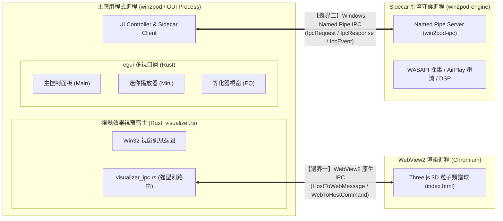

# Win2Pod 嚴格型別化跨進程 IPC 契約規格書
# (Type-Safe Cross-Process IPC Contract Specification)

## 1. 概述與 IPC 拓撲全景 (Architecture Overview)

Win2Pod 採用分離式多進程（Multi-Process）與多視口（Multi-Viewport）架構。為兼顧「高保真音訊 DSP 零卡頓」、「現代化 WebGL 3D 視覺特效呈現」以及「低干擾獨立視窗生命週期」，系統內建立了兩大截然不同但皆要求極致強健的跨進程通訊（IPC）邊界：



---

## 2. 邊界一：Visualizer WebView2 雙向強型別契約

視覺效果視窗透過微軟原生 WebView2 託管 WebGL 渲染管線。Rust 宿主負責推送 60 FPS 音訊 FFT 頻譜並管理桌面吸附與透明度；Web 前端負責呈現 3D 動畫與接收使用者操作。

### 2.1 歷史缺陷：字串嗅探與動態字典反模式
在早期實作中，此通道存在嚴重型別漏洞：
1. **子字串嗅探（Substring Sniffing）**：
   Rust 端使用 `if body.contains("close")` 判定命令。當前端送出 `"close_cluster"` 時，若順序判定不當，極易被 `"close"` 分支攔截誤判；`"minimize_solo"` 亦容易與 `"minimize"` 產生包含歧義。
2. **動態字典開銷與拼寫無防護**：
   Rust 往前端廣播頻譜與狀態時，散落了大量 `serde_json::json!({ "type": "...", ... })`。這不僅每秒產生 60 次動態 Heap 記憶體分配，且編譯器完全無法在編譯期驗證鍵名拼寫（例如曾將 `&spectrum[..]` 誤當為浮點數陣列而無任何編譯期警告）。

### 2.2 現代化協定塑模 (`crates/homepod-cast-gui/src/visualizer_ipc.rs`)

#### (1) Rust $\to$ WebView2：零動態 Heap 分配訊息 (`HostToWebMessage<'a>`)
採用帶生命週期標註的借用結構體（Borrowing Slices）：

```rust
/// Strongly-typed outgoing messages sent from Rust to WebView2.
#[derive(Debug, Clone, Serialize)]
#[serde(tag = "type")]
pub enum HostToWebMessage<'a> {
    #[serde(rename = "spectrum")]
    Spectrum {
        /// 借用原始 0~255 正規化頻譜位元組切片，直達底層 COM 記憶體，零額外複製
        data: &'a [u8],
    },
    #[serde(rename = "init_state")]
    InitState {
        lang: &'a str,
        pinned: bool,
        badge: &'a str,
        docked: bool,
    },
    #[serde(rename = "set_language")]
    SetLanguage {
        lang: &'a str,
    },
    #[serde(rename = "title_badge")]
    TitleBadge {
        badge: &'a str,
        docked: bool,
    },
    #[serde(rename = "vis_pin_changed")]
    VisPinChanged {
        pinned: bool,
        from_host: bool,
    },
    #[serde(rename = "vis_fullscreen_changed")]
    VisFullscreenChanged {
        fullscreen: bool,
    },
    #[serde(rename = "sync_opacity")]
    SyncOpacity {
        val: u32,
        show_hud: bool,
    },
}
```

* **發送端封裝**：
  ```rust
  pub fn post_web_message(wv: &wry::WebView, msg: &HostToWebMessage) {
      if let Ok(json_str) = serde_json::to_string(msg) {
          post_web_message_json(wv, &json_str);
      }
  }
  ```

#### (2) WebView2 $\to$ Rust：強型別命令解析 (`WebToHostCommand`)

```rust
/// Strongly-typed incoming commands sent from WebView2 to Rust Host.
#[derive(Debug, Clone, PartialEq, Deserialize, Serialize)]
#[serde(tag = "action", content = "payload")]
pub enum WebToHostCommand {
    #[serde(rename = "close")]
    Close,
    #[serde(rename = "close_cluster")]
    CloseCluster,
    #[serde(rename = "minimize")]
    Minimize,
    #[serde(rename = "minimize_solo")]
    MinimizeSolo,
    #[serde(rename = "start_drag")]
    StartDrag,
    #[serde(rename = "fullscreen")]
    ToggleFullscreen,
    #[serde(rename = "toggle_pin")]
    TogglePin,
    #[serde(rename = "ready")]
    VisReady,
    #[serde(rename = "show_main")]
    ShowMain,
    #[serde(rename = "wake_ghost")]
    WakeGhost,
    #[serde(rename = "wake_ghost_solo")]
    WakeGhostSolo,
    #[serde(rename = "toggle_opacity")]
    ToggleOpacity,
    #[serde(rename = "toggle_opacity_solo")]
    ToggleOpacitySolo,
    #[serde(rename = "set_opacity")]
    SetOpacity { pct: f32 },
    #[serde(rename = "set_opacity_solo")]
    SetOpacitySolo { pct: f32 },
    #[serde(rename = "opacity_menu_open")]
    OpacityMenuOpen { is_open: bool },
    #[serde(rename = "set_hover_peek")]
    SetHoverPeek { enabled: bool },
    #[serde(rename = "suppress_peek")]
    SuppressPeek { suppress: bool },
    #[serde(rename = "vis_mouse_enter")]
    MouseEnter,
    #[serde(rename = "vis_mouse_leave")]
    MouseLeave,
}
```

* **安全雙模式解析器（Dual-Mode Parser）**：
  `WebToHostCommand::parse(raw: &str)` 同時支援現代標準 JSON 物件（如 `{"action":"set_opacity","payload":{"pct":85.0}}`）與舊式前置詞元字串（如 `"set_opacity:85.0"`、`"minimize_solo"`），保證向前與向後相容。

* **接收端窮舉模式匹配**：
  在 `visualizer.rs` 中使用 `match cmd { WebToHostCommand::... => ... }`，徹底杜絕任何分支漏判。

---

## 3. 邊界二：GUI 前端進程 $\longleftrightarrow$ Sidecar 引擎 (Named Pipe IPC)

此通道基於 Windows 原生命名管道（Named Pipe: `\\.\pipe\win2pod-bridge-ipc`），負責高階控制命令與底層 AirPlay / 音訊串流狀態的即時回報。

### 3.1 協定架構 (`crates/win2pod-ipc`)

```rust
/// 全域 IPC 封包信封
#[derive(Debug, Clone, Serialize, Deserialize)]
#[serde(tag = "type", content = "payload")]
pub enum IpcMessage {
    Request(IpcRequest),
    Response(IpcResponse),
    Event(IpcEvent),
}
```

#### (1) GUI 主動請求 (`IpcRequest`)
涵蓋完整控制指令：
* `Ping { nonce: u64 }`
* `DiscoverDevices { timeout_secs: u64 }`
* `Connect { target: ConnectTargetIpc, volume: f32, low_latency: bool }`
* `Disconnect`
* `SetVolume { volume: f32, device_id: Option<String> }`
* `SetEq { enabled: bool, gains: [f32; 10], enhancer_mode: u8, warmth_mode: u8 }`
* `SetAudioSource { source: AudioSourceIpc }`
* `SetAirPlayReceiver { ... }`
* `SetAirPodsMonitoring { enabled: bool }`
* `EnumerateAudioEndpoints`
* `SetEngineMode { mode: EngineModeIpc }`
* `GetStatus`
* `Shutdown`

#### (2) Sidecar 引擎應答 (`IpcResponse`)
* `Pong { nonce: u64 }`
* `Ok`
* `Error(String)`
* `Status(EngineStatusIpc)`
* `AudioEndpoints(Vec<AudioEndpointIpc>)`

#### (3) 異步事件串流 (`IpcEvent`)
引擎主動向 GUI 推送的高頻非同步廣播：
* `DeviceDiscovered(DeviceIpc)`
* `StreamingStateChanged { state: StreamStateIpc, ... }`
* `DiagnosticsUpdate(DiagnosticsIpc)`（RTT、時鐘偏移、封包丟失率）
* `AirPodsStateUpdate(AirPodsStatusIpc)`（入耳偵測、電量）
* `ReceiverStateUpdate(ReceiverStatusIpc)`（AirPlay 接收端曲目中繼資料、封面位元組）
* `AudioActivityChanged { is_active: bool, peak_level: f32 }`
* `RawSpectrumUpdate(Vec<u8>)`

### 3.2 傳輸層實踐 (`crates/win2pod-ipc/src/transport.rs`)
* 換行定界 JSON（Newline-Delimited JSON / NDJSON），確保在 Windows 命名管道傳輸流中具備清晰的封包邊界。
* 具備指數退避自動重試的連線機制（`connect_pipe_client`）。

---

## 4. 全系統 IPC 協定矩陣對照表 (Protocol Comparison Matrix)

| 比較特性 | 【邊界一】Visualizer WebView2 IPC | 【邊界二】Sidecar Named Pipe IPC |
| :--- | :--- | :--- |
| **通訊進程** | GUI 進程 $\leftrightarrow$ Chromium 渲染進程 | GUI 進程 $\leftrightarrow$ Sidecar 守護進程 |
| **底層載體** | Windows COM `ICoreWebView2::PostWebMessageAsJson` / Mojo IPC | Windows Named Pipe (`\\.\pipe\win2pod-bridge-ipc`) |
| **訊框定界** | Chromium 核心原生 Message 事件封裝 | Newline-Delimited JSON (`\n`) |
| **型別定義檔** | `crates/homepod-cast-gui/src/visualizer_ipc.rs` | `crates/win2pod-ipc/src/protocol.rs` |
| **主要資料流** | 60 FPS 音訊頻譜陣列、吸附/全螢幕/透明度同步 | AirPlay 串流控制、DSP 等化器係數、診斷遙測 |
| **延遲等級** | **極致低延遲**（$< 1\text{ms}$，直接共享緩衝區） | **低延遲**（$< 2\text{ms}$，原生命名管道） |
| **安全性機制** | 借用切片零複製序列化、強型別雙向枚舉解析 | 獨立進程沙盒隔離、Windows ACL 安全描述子保護 |

---

## 5. 結論與維護規範

透過建立 **嚴格型別化（Type-Safe）跨進程 IPC 契約**，Win2Pod 達成了：
1. **編譯期即除錯（Compile-Time Correctness）**：任何欄位增減、名稱變更皆能被 rustc 靜態捕捉，不再因前端鍵名手誤造成介面靜默失效。
2. **零垃圾字串分配（Zero-Jank Stream）**：高頻頻譜通道消滅動態 AST 結構分配，維持穩定的 60 FPS 渲染。
3. **架構模組化高內聚**：進程與模組之間僅依賴純協定 DTO，不產生運行時的二進位或符號耦合。
