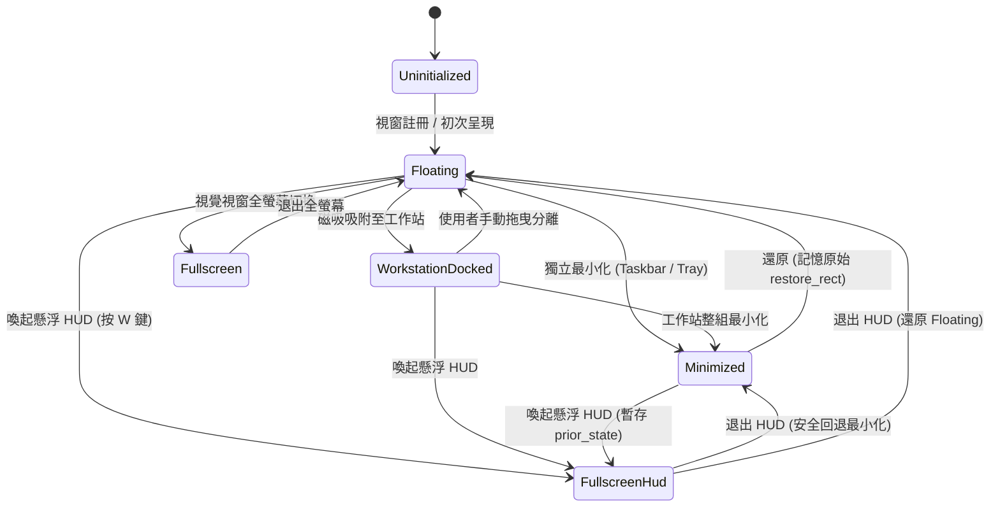
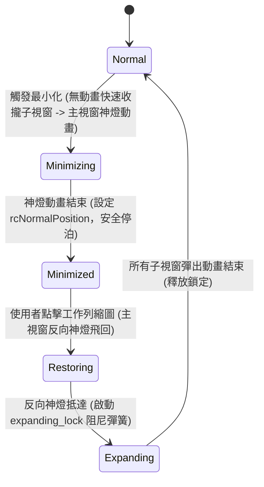
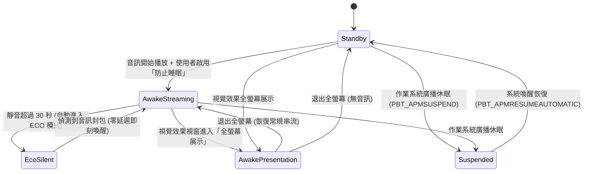

# Win2Pod 視窗架構與狀態機重構全景紀錄

> 本文深入記錄 Win2Pod 在多視窗管理、Win32 狀態時序競態、神燈/彈簧動畫還原異常、視覺效果視窗（Visualizer）、以及**全系統狀態機（Finite State Machine, FSM）模組化重構**的核心架構與實踐心得。

---

## 一、 問題背景與排查歷程

在模組化工作站（Modular Workstation）架構下，Win2Pod 包含四個高度連動的視窗：
1. **主視窗（Main Window）**：AirPlay 設備管理核心、各子視窗控制器。
2. **迷你播放器（Mini Player）**：精巧播放控制器。
3. **等化器（Equalizer）**：雙 10 頻段獨立 DSP 調音台。
4. **視覺效果視窗（Visualizer）**：WebView2 驅動的 3D WebGL 粒子頻譜球。

隨著視窗吸附（Magnetic Snapping）、神燈最小化動畫（Muelle Genie S-Curve）、彈簧收合展開（Spring Overshoot）以及全螢幕 HUD 等進階功能疊加，底層 Win32 原生行為與上層狀態管理產生了多次深層競態。

---

## 二、 關鍵缺陷與底層根因剖析（Root Cause Deep-Dive）

### 1. 主視窗反向神燈還原後瞬間閃現至螢幕中央
* **表象**：工作站最小化還原時，主視窗先順暢跑完阿拉丁神燈動畫到達還原點，但在子視窗彈出前一瞬間，突然閃爍瞬移到螢幕中央。
* **深層根因**：
  - 神燈動畫收縮至工作列時，為了隱藏原始視窗，會將視窗移至離屏座標 `(-32000, -32000)`。
  - 當反向神燈動畫播放完畢，呼叫 Win32 `ShowWindow(h, SW_RESTORE)`。
  - Win32 系統同步拋出 `WM_SIZE(SIZE_RESTORED)` 訊息。原程式碼在該回呼中同步呼叫了 `ensure_window_on_screen(hwnd)`。
  - 此時視窗實體剛從離屏喚醒，`GetWindowRect` 讀到的座標仍是 `-32000`。
  - `ensure_window_on_screen` 誤判定視窗「遺失在螢幕邊界之外」，觸發安全保底邏輯：強制將視窗搬移到 `(work.right - w) / 2` 與 `(work.bottom - h) / 2`（螢幕正中央）。
* **解法**：
  - 在 `WM_SIZE` 回呼中徹底移除粗暴的 `ensure_window_on_screen`。
  - 在 `ensure_window_on_screen` 內部加上嚴格保護條件：若視窗為最小化（`IsIconic`）或處於離屏隱藏座標（`rect.left <= -10000`），立刻中斷退出，不得擅自竄改視窗座標。

---

### 2. 子視窗獨立最小化在工作列縮圖被擠成極小方塊且無法還原
* **表象**：迷你播放器或等化器獨立最小化到工作列後，滑鼠懸停在工作列圖示上，DWM 縮圖預覽被壓成左上角一個極小的小灰塊（僅有標題列一角），且點擊縮圖無法還原視窗。
* **深層根因**：
  - Windows DWM（Desktop Window Manager）渲染工作列即時縮圖時，依賴視窗資料結構 `WINDOWPLACEMENT.rcNormalPosition` 作為還原畫布的寬高基準。
  - 原神燈模組在最小化前將視窗停泊在 `(-32000, -32000)`，接著呼叫 `ShowWindow(SW_MINIMIZE)`。
  - Win32 的底層行為是：當視窗座標處於 `-32000` 時調用 `SW_MINIMIZE`，Windows 會直接把 `-32000, -32000, -32000, -32000` 存入 `rcNormalPosition`！
  - 結果：DWM 拿到的正常尺寸寬高變成 0（被系統強制 clamp 成微小碎片）；更嚴重的是，當使用者點擊工作列縮圖試圖還原時，Windows 嘗試還原到 `rcNormalPosition`（即 `-32000`），視窗永遠停在離屏不可見區域！
* **解法**：
  - 在 `genie_effect.rs` 執行 `ShowWindow(SW_MINIMIZE)` 之後，立即以顯式呼叫 `SetWindowPlacement`，將視窗原本記錄的正確寬高與座標重新填入 `rcNormalPosition`。
  - 在 `snapping.rs` 的 `minimize_window_solo` 與 `restore_window_animated` 中，精確同步單獨視窗的 `ClusterState::Minimized` 與實體記錄，徹底修復 DWM 預覽與工作列點擊還原。

---

### 3. 視覺視窗高度「忽長忽矮」的動態錨定
* **表象**：視覺視窗單獨誕生或隨工作站排版時，偶爾高度縮水或與主視窗不齊平。
* **根因與解法**：
  - 視覺效果視窗本質是音樂工作站的「動態側翼」。過去因缺乏統一權威尺寸出口，容易受到初始化預設值干擾。
  - 在 `WindowManager` 中建立單一權威誕生入口 `get_visualizer_spawn_rect()`：
    - **高度錨定**：視覺視窗高度永遠動態抓取主視窗當前的即時物理高度 `(main_r.bottom - main_r.top).max(500)`。
    - **寬度尊重**：若使用者曾手動拉伸過視覺視窗，尊重其自訂寬度；否則套用經典黃金比例 720px。
    - **位置附著**：預設精確誕生於主視窗右緣，形成天衣無縫的模組化外觀。

---

## 三、 全系統狀態機矩陣架構重構（State Machine Architecture Matrix）

為徹底杜絕跨執行緒競態、非同步時序相依與介面「幽靈狀態」，Win2Pod 重構並確立了 **7 大核心狀態機**：

### 1. 視窗實體生命週期狀態機（Window Lifecycle FSM）
* **所在位置**：`window_entity.rs` / `window_manager.rs`
* **封裝設計**：每個 `ManagedWindow` 視窗實體擁有一組獨立、高內聚的狀態機，杜絕外部任意調用 Win32 API。

* **核心不變量（Invariants）**：
  - **Hardware Clamp 保證**：任何狀態轉移前，目標座標必須通過該視窗的硬體黃金比例限制（如 Main 最小 $380 \times 500$），永遠不可能出現元件被擠爆或裁切。
  - **HUD 安全回退**：`FullscreenHud` 內部持有 `prior_state: Box<WindowLifecycleState>`。退出全螢幕或關閉 HUD 時，精確還原進 HUD 前的狀態；若原本在工作列最小化，退出 HUD 後**絕對維持最小化**，嚴禁擅自彈出！

---

### 2. 工作站叢集與動畫交接狀態機（Cluster & Animation Handover FSM）
* **所在位置**：`snapping.rs` / `genie_effect.rs`
* **解決問題**：工作站包含 2~4 個視窗時，最小化必須先收攏子視窗再由主視窗跑神燈動畫；還原時必須先反向神燈回位，再以物理彈簧曲線（Spring Overshoot）梯次彈出子視窗。

* **核心不變量**：
  - **單一 vs 叢集最小化隔離**：若子視窗已脫離叢集獨立浮動，點擊最小化只觸發 `minimize_window_solo`，不影響其他視窗；主視窗最小化時，若叢集有成員，則扮演叢集 Root 帶領整組收納。
  - **Expanding 動畫鎖**：在彈簧動畫震盪期間，鎖定幾何計算，防止使用者在此時拖曳造成彈簧座標混亂。

---

### 3. 系統電源與睡眠抑制狀態機（Power & Sleep Suppression FSM）
* **所在位置**：`power.rs`
* **解決問題**：Windows API `SetThreadExecutionState` 具有嚴格的**作業系統執行緒親和性（Thread Affinity）**。若在非同步 Tokio Worker 呼叫 `ES_SYSTEM_REQUIRED`，隨後在另一個 Worker 呼叫 `ES_CONTINUOUS`，電源鎖會遺失在 Windows 核心核心中（`powercfg /requests` 殘留），導致電腦永遠無法休眠。
* **架構方案**：建立專屬常駐原生執行緒 `win2pod-power-arbiter`，由純函式狀態機 `PowerStateMachine` 專利驅動。

* **硬體動作映射（Hardware Actions）**：
  - `AwakePresentation` $\to$ `ES_CONTINUOUS | ES_SYSTEM_REQUIRED | ES_DISPLAY_REQUIRED`（螢幕不關閉、主機不睡眠）。
  - `AwakeStreaming` $\to$ `ES_CONTINUOUS | ES_SYSTEM_REQUIRED`（螢幕可關閉、音樂不中斷）。
  - `Standby` / `EcoSilent` / `Suspended` $\to$ `ES_CONTINUOUS`（完全放行，允許 Windows 自然睡眠）。

---

### 4. 視窗透明度與懸停探視狀態機（Window Opacity & Hover Peek FSM）
* **所在位置**：`snapping.rs`
* **狀態邏輯**：
  - `Normal`：全不透明（Alpha 255）。
  - `Faded`：使用者自訂半透明模式（30% ~ 100% 透明度）。
  - `HoverPeek`：當視窗半透明時，滑鼠移入（Hover）暫時平滑淡入至 100% 不透明度；滑鼠移出後淡回 `Faded`。
  - `ClickThrough`：滑鼠穿透模式（`WS_EX_TRANSPARENT`）。
* **狀態機保護**：
  - 在使用者移動（`WM_MOVING`）或縮放（`WM_SIZING`）視窗期間，強制壓制（Suppress）探視與透明度切換，防止 DWM 混合器高頻重畫產生閃爍。

---

### 5. 音訊活動與節能計時狀態機（Audio Activity & 30s Silence Detection FSM）
* **所在位置**：`spectrum.rs` / `audio_manager.rs`
* **機制**：
  - 音訊 DSP 處理管線在即時輸出 PCM 時，持續刷新原子單調時間戳 `LAST_AUDIO_ACTIVE_TS`。
  - 提供極速快路徑 `is_audio_active_30s()`，單次 Relaxed 原子讀取開銷 $< 1\text{ns}$，無任何系統呼叫（Syscall）。
  - 當靜音超過 30 秒，觸發 ECO 模式；DSP 或後端捕捉到首個音訊封包時，透過 `WM_USER_WAKE_ECO` 零延遲（Zero Latency）瞬間喚醒前端。

---

### 6. 引擎側車守護進程狀態機（Sidecar Engine Lifecycle FSM）
* **所在位置**：`sidecar_fsm.rs`
* **狀態流轉**：
  `Stopped` $\longrightarrow$ `Starting` $\longrightarrow$ `Running` $\longrightarrow$ `Crashed`（指數退避重試）$\longrightarrow$ `Exhausted`。
* **防護核心**：
  - **防止殭屍重啟（Prevent Zombie Resurrect）**：當應用程式進入關閉程序或收到結束指令時，狀態機嚴格凍結，保證在關閉過程中不會因為進程退出觸發崩潰重試而死者復生。

---

### 7. 應用程式全域生命週期狀態機（App Lifecycle FSM）
* **所在位置**：`app_lifecycle.rs`
* **防護核心**：
  - Windows 原生電源事件（如筆電闔蓋休眠）常伴隨多次連續的重入（Re-entrant）廣播。
  - 狀態機引入 `Draining` 攔截機制，在作業系統掛起時依序阻斷 IPC、停用音訊管線、凍結定時器；喚醒時再以有序階梯（Staggered Wake）重新初始化硬體，杜絕崩潰與音訊爆音。

---

## 四、 電源管理與視覺美學的思辨：方案 A（怠速漫遊）

在討論「ECO 模式（靜音 > 30s）視覺視窗是否該停止運動」時，我們釐清了 Windows 作業系統底層的電源運作原理：

### 1. Windows 的睡眠真相
> **「Windows 判斷電腦是否閒置，只看鍵盤滑鼠輸入與 Win32 電源鎖（`SetThreadExecutionState`），完全不在乎螢幕上有沒有 3D 動畫在動。」**

瀏覽器開啟動態網頁或 WebGL 動畫時，只要使用者不碰滑鼠，Windows 預設時間一到照樣會關閉螢幕並睡眠。因此，**強制凍結 WebGL 渲染迴圈並不是讓 Windows 睡眠的必要條件**。

### 2. 方案 A 的美學與效能平衡
- **原本做法（硬性凍結）**：呼叫 `renderer.setAnimationLoop(null)`，球體瞬間卡死在某一角度，使用者直覺會誤以為軟體當機或顯示驅動異常。
- **方案 A（怠速漫遊，採用）**：
  1. **前端保持呼吸運轉**：不中止 Three.js 渲染迴圈。在無頻譜時，`controls.autoRotateSpeed` 維持 0.5 慢速自轉，粒子光波以極低功耗漫遊漂移，極具精緻生命力。
  2. **後端降頻節能**：Rust 端的頻譜掃描 Timer 在靜音 > 30s 時，由 16ms 降至 100ms（節省 CPU 輪詢與 IPC 序列化開銷）。
  3. **電源徹底放行**：後台 `PowerArbiter` 照常向 Windows 發送 `AllowSleep`，一切遵循使用者的作業系統休眠設定。

---

## 五、 結論與後續維護指引

經過此次重構，Win2Pod 的多模組狀態機達到了高度自洽與解耦：
- **狀態自洽**：所有視窗尺寸與幾何具有單一真理源（Single Source of Truth），徹底告別座標競態。
- **動效精緻**：神燈動畫與彈簧阻尼展開平滑流暢，縮圖預覽清晰無瑕。
- **體驗靈動**：視覺視窗兼顧極致省電與全天候靈動美感。
- **全狀態機矩陣可測性**：各模組狀態機皆具備獨立的純邏輯測試覆蓋（73 項單元測試全數通過）。

*相關檔案參考：*
- 視窗實體狀態機：[window_entity.rs](file:///C:/Users/mesme/workspace/win2pod-bridge/crates/homepod-cast-gui/src/window_entity.rs)
- 視窗管理協調器：[window_manager.rs](file:///C:/Users/mesme/workspace/win2pod-bridge/crates/homepod-cast-gui/src/window_manager.rs)
- 吸附與叢集動畫引擎：[snapping.rs](file:///C:/Users/mesme/workspace/win2pod-bridge/crates/homepod-cast-gui/src/snapping.rs)
- 神燈幾何特效：[genie_effect.rs](file:///C:/Users/mesme/workspace/win2pod-bridge/crates/homepod-cast-gui/src/genie_effect.rs)
- 專屬電源仲裁執行緒：[power.rs](file:///C:/Users/mesme/workspace/win2pod-bridge/crates/homepod-cast-gui/src/power.rs)
- 側車引擎生命週期：[sidecar_fsm.rs](file:///C:/Users/mesme/workspace/win2pod-bridge/crates/homepod-cast-gui/src/sidecar_fsm.rs)
- 應用程式生命週期防護：[app_lifecycle.rs](file:///C:/Users/mesme/workspace/win2pod-bridge/crates/homepod-cast-gui/src/app_lifecycle.rs)
- 視覺效果前端：[index.html](file:///C:/Users/mesme/workspace/win2pod-bridge/crates/homepod-cast-gui/assets/visualizer/index.html)
