# Win2Pod 視窗實體與吸附叢集分層架構規格書
# (Window Entity vs. Snapping Cluster Architecture Specification)

## 1. 概述與架構願景

Win2Pod (原 HomePod Cast) 是 Windows 平台上的多視窗高保真音訊控制與視覺化工作站。在原生 Windows (Win32) API 規範中，作業系統僅將每個視窗視為獨立個體，缺乏「多視窗組合磁吸（Docking）」、「工作站叢集聯動（Cluster Synchronization）」以及「階層式主從最小化/還原」的協同架構。

若未進行清晰的分層設計，多視窗吸附系統極易陷入以下三大經典工程陷阱：
1. **拓撲連鎖震盪（Ping-Pong Oscillation）**：視窗 A 牽引視窗 B、視窗 B 回推視窗 A，導致 `WM_MOVING` 訊息陷入無窮遞迴死鎖。
2. **幾何邊界污染（Iconic Rect Squashing）**：原生 Win32 最小化時會將視窗尺寸壓縮為 `(180, 27)` 或位移至 `(-32000, -32000)`，破壞視窗記憶座標與吸附邊界。
3. **感知與物理狀態混亂（FSM State Collision）**：透明度漸變、穿透點擊（Ghost Mode）、滑鼠懸停預覽（Hover Peek）與最小化彈簧動畫（Spring Physics）相互交錯覆蓋，產生螢幕殘影或視窗失聯。

為了徹底解決上述問題，我們將視窗系統解耦為清晰的 **6 層架構堆疊（6-Layer Architectural Stack）**，明確劃分「單一視窗實體約束」與「多視窗叢集拓撲動態」。

---

## 2. 6 層架構堆疊全貌 (Architectural Stack)

```mermaid
flowchart TD
    subgraph L6["Layer 6: UI Presentation & Viewport Runtime (UI 表現與視口運行層)"]
        UI_EGUI["eframe / egui 多視口渲染調度"]
        UI_VIEWS["頁面視圖 (Main, Mini, EQ, Visualizer)"]
        UI_COMPONENTS["Winamp 復古外殼、工作站按鈕、標題列控制"]
        UI_WEBVIEW["WebView2 原生 JSON 訊息通道"]
    end

    subgraph L5["Layer 5: Perception & Transparency FSM (視覺感知與透明度狀態機)"]
        ALPHA_FSM["GhostAlphaFSM (半透明穿透狀態機)"]
        ALPHA_PEEK["Hover Peek 懸停預覽機制"]
        ALPHA_PIN["Topmost 頂層置頂仲裁"]
        ALPHA_TRACK["滑鼠邊界延遲離開追蹤器"]
    end

    subgraph L4["Layer 4: Motion Physics & Cluster FSM (運動物理與叢集協調層)"]
        MOTION_FSM["ClusterMotionFSM (最小化/還原/重組 4 階段 FSM)"]
        SPRING_PHYSICS["MagSafe 阻尼超調物理曲線 (spring_overshoot_curve)"]
        TASKBAR_MGR["ITaskbarList3 系統工作列圖示動態收合"]
        WORKSTATION_LAYOUT["工作站磁吸幾何排版演算法"]
    end

    subgraph L3["Layer 3: Topology & Graph Arbitration (叢集拓撲學與仲裁層)"]
        DOCK_EDGES["無向接觸圖 (Undirected Contact Graph: DOCK_EDGES)"]
        DOCK_TREE["有向主從生成樹 (Directed Tree Forest: DOCK_TREE)"]
        PRIORITY_SORT["優先級仲裁器 (Main > Mini > EQ > Visualizer)"]
        MOVE_PROP["單向位移傳遞引擎 (One-Way Move Propagation)"]
    end

    subgraph L2["Layer 2: Entity Constraints & State Protection (視窗實體約束層)"]
        ENTITY_RECT["邏輯幾何邊界保護 (Logical Rect Protection)"]
        ICONIC_SHIELD["Win32 180x27 最小化尺寸防污染夾具 (Geometry Clamp)"]
        ROLE_BINDING["視窗角色屬性 (WindowRole: Primary vs Satellite)"]
        BOUNDS_SAFETY["安全螢幕工作區邊界限制 (Work Area Restrictor)"]
    end

    subgraph L1["Layer 1: OS Interop & Hooking (Win32 原生互操作底層)"]
        SUBCLASS_PROC["SetWindowSubclass 原生視窗程序掛鉤"]
        MSG_INTERCEPT["WM_SYSCOMMAND / WM_MOVING / WM_ENTERSIZEMOVE 攔截"]
        DPI_AWARE["多螢幕 Per-Monitor DPI 感知換算"]
        RAW_USER32["SetWindowPos / DeferWindowPos 批次原子位移"]
    end

    L6 --> L5
    L5 --> L4
    L4 --> L3
    L3 --> L2
    L2 --> L1
```

---

## 3. 各層深入解析與職責規範

### Layer 1: OS Interop & Hooking (Win32 原生互操作層)
- **原始碼路徑**：`crates/homepod-cast-gui/src/snapping/subclass.rs`
- **核心職責**：
  - 封裝 Windows `user32.dll` 與 `comctl32.dll` 的原生 API 調用。
  - 透過 `SetWindowSubclass` / `RemoveWindowSubclass` 為每個 egui Viewport HWND 安裝視窗鉤子。
  - **核心攔截清單**：
    - `WM_SYSCOMMAND (SC_MINIMIZE / SC_RESTORE)`：阻斷 Windows 預設的非同步視窗收合，將控制權移交給 Layer 4 的 `ClusterMotionFSM`。
    - `WM_ENTERSIZEMOVE` / `WM_EXITSIZEMOVE`：捕獲使用者手勢開始與結束，鎖定吸附運算上下文。
    - `WM_MOVING`：在使用者拖曳視窗邊界即時回傳時，通知 Layer 3 進行磁吸吸附演算與同動推移。
    - `WM_ACTIVATE` / `WM_NCACTIVATE`：維持多視窗同時處於「啟動/非中斷」視覺表現。

### Layer 2: Entity Constraints & State Protection (視窗實體約束層)
- **原始碼路徑**：
  - `crates/homepod-cast-gui/src/window_entity.rs`
  - `crates/homepod-cast-gui/src/window_manager.rs`
- **核心職責**：
  - 代表「單一獨立視窗」的狀態實體，嚴格不涉入其他視窗的存在與拓撲關係。
  - **幾何保護盾 (Iconic Geometry Shield)**：
    Win32 原生最小化時，`GetWindowRect` 會返回特殊的最小化佔位尺寸（如寬度 180、高度 27，或負三萬像素座標）。Layer 2 透過 `clamp_minimum_geometry_bounds` 與快取記憶體記錄 `last_restored_rect`，保證邏輯尺寸絕對不受系統干擾破壞。
  - **語意屬性**：
    - `WindowRole`：標記主控視窗（`Primary`，如 主面板/Mini面板）或從屬視窗（`Satellite`，如 等化器/視覺化視窗）。
    - `WindowKind`：區分各功能視窗實體。

### Layer 3: Topology & Graph Arbitration (叢集拓撲學與仲裁層)
- **原始碼路徑**：
  - `crates/homepod-cast-gui/src/snapping/cluster.rs`
  - `crates/homepod-cast-gui/src/snapping/geometry.rs`
  - `crates/homepod-cast-gui/src/snapping/types.rs`
- **詳細設計專題**：[SNAPPING_TOPOLOGY_AND_LOCK_CENTRALIZATION_INSIGHTS.md](file:///C:/Users/mesme/workspace/win2pod-bridge/docs/SNAPPING_TOPOLOGY_AND_LOCK_CENTRALIZATION_INSIGHTS.md)
- **核心職責**：
  - 負責視窗之間的吸附幾何關係、邊界接觸檢測與主從架構仲裁。
  - **純邏輯資料結構 (`ClusterTopology`)**：
    將接觸邊集合、主從樹映射與快取座標整併為統一的 `ClusterTopology` 結構體。演算法運作期間 0 個 Win32 依賴、0 個 Mutex 鎖，100% 離線可測。
  - **快照式無鎖計算模式（Snapshot Pattern）**：
    在推導停靠目標（`compute_cluster_docked_targets`）或重建樹（`rebuild_dock_tree`）時，以 $< 1\mu\text{s}$ 複製局部不可變快照後立即釋放鎖，在快照上進行無鎖幾何演算，徹底消除巢狀重入死鎖（Anti-Deadlock）。
  - **接觸圖（Contact Graph）至 生成樹（Directed Tree）演算法**：
    1. **無向接觸圖 (`edges`)**：
       當兩視窗相鄰在吸附容差半徑（Snap Threshold，如 16px）且平行重疊長度足夠時，記錄雙向接觸邊（包含 `DockSide`: Left, Right, Top, Bottom 與 `DockBond`）。
    2. **嚴格優先級仲裁（Arbitration Hierarchy）**：
       $$\text{Main} (4) > \text{MiniPlayer} (3) > \text{Equalizer} (2) > \text{Visualizer} (1)$$
    3. **定向生成樹 (`tree`)**：
       在每次移動事件觸發時，由被拖曳視窗作為根節點（Root），或由高優先級視窗單向指向低優先級視窗，將無向網狀接觸圖即時退化為 **有向無環樹（Directed Acyclic Forest）**。
    4. **消除連鎖迴圈（Anti-Loop Propagation）**：
       位移傳遞（Move Propagation）僅由 Parent 走訪 Children，絕不向上反饋，以數學保證永遠不發生循環推動（Ping-Pong Deadlock）。
    5. **工作站佈局演算**：`find_best_spawn_rect` 與 `compute_workstation_targets`。
    4. **消除連鎖迴圈（Anti-Loop Propagation）**：
       位移傳遞（Move Propagation）僅由 Parent 走訪 Children，絕不向上反饋，以數學保證永遠不發生循環推動（Ping-Pong Deadlock）。

### Layer 4: Motion Physics & Cluster FSM (運動物理與叢集協調層)
- **原始碼路徑**：
  - `crates/homepod-cast-gui/src/snapping/animation.rs`
- **核心職責**：
  - 管理整個視窗叢集的連動動力學與多視窗生命週期協調。
  - **叢集動作狀態機 (`ClusterMotionFSM`)**：
    - `Idle`：常態靜止狀態。
    - `SnappingSpring`：視窗釋放後進行 MagSafe 磁吸就位動畫。
    - `ClusteringMinimize`：主視窗最小化時，依序收回所有吸附衛星視窗，淡出並於 Taskbar 隱藏。
    - `Restoring`：主視窗恢復時，依據歷史吸附拓撲以彈簧曲線展開叢集。
    - `WorkstationDeploy`：使用者點擊「工作站模式」時，自動按黃金佈局召回並鎖定所有分離視窗。
  - **物理彈簧曲線 (`spring_overshoot_curve`)**：
    採用帶有微幅阻尼超調（Overshoot Damping）的二階物理公式：
    $$f(t) = 1.0 - e^{-\zeta \omega t} \cdot \cos(\omega \sqrt{1 - \zeta^2} \cdot t)$$
    提供類似 macOS / iOS 的真實彈力手感，而非呆板的線性差值。
  - **Windows 工作列整合 (`ITaskbarList3`)**：
    在叢集收合時動態呼叫 `DeleteTab` / `AddTab`，確保 Windows 工作列僅保留單一主控制項，不產生分散視窗殘影。

### Layer 5: Perception & Transparency FSM (視覺感知與透明度狀態機)
- **原始碼路徑**：
  - `crates/homepod-cast-gui/src/snapping/opacity.rs`
- **核心職責**：
  - 提供視覺通透性與穿透交互體驗，避免視窗遮擋使用者日常桌面作業。
  - **幽靈穿透狀態機 (`GhostAlphaFSM`)**：
    - `Normal`：100% 不透明，正常響應點擊。
    - `Ghost`：40% 半透明，啟用 Win32 `WS_EX_TRANSPARENT`，滑鼠點擊直接穿透到底層程式。
    - `HoverPeek`：當滑鼠懸停於幽靈視窗上方時，短暫平滑漸變至 100% 透明度以供讀取資訊，但不搶奪鍵盤焦點；滑鼠離開後經防抖延遲計時器（Debounced Exit Timer）自動淡回 40%。
  - **頂層置頂仲裁 (`Topmost`)**：
    協同叢集內各視窗的 `HWND_TOPMOST` 順序，確保穿透視窗永遠漂浮在桌面之上。

### Layer 6: UI Presentation & Viewport Runtime (UI 表現與視口運行層)
- **原始碼路徑**：
  - `crates/homepod-cast-gui/src/gui/mod.rs`
  - `crates/homepod-cast-gui/src/gui/types.rs`
  - `crates/homepod-cast-gui/src/gui/components.rs`
  - `crates/homepod-cast-gui/src/gui/views/*`
- **核心職責**：
  - 核心繪圖調度：驅動 egui `multi-viewport` 渲染管線。
  - 視覺風格呈現：Winamp 復古機殼面板、流暢切換的分頁導航、高對比視覺化儀表。
  - 外部現代通訊：在視覺化視窗內透過原生 `postMessage` JSON 協定與 WebView2 雙向通訊，完全摒除低效的字串指令注入。

---

## 4. 關鍵設計原則與隔離邊界

| 設計維度 | 實體約束層 (Entity: L1-L2) | 叢集拓撲層 (Cluster: L3-L4) |
| :--- | :--- | :--- |
| **存在目標** | 保障單一 HWND 之物理幾何、DPI 與防崩潰邊界 | 處理多 HWND 間的力學吸附、拓撲圖演算法與群組動作 |
| **知曉範圍** | 僅知道自己本身的座標、尺寸與保護邊界 | 掌握全域全視窗座標矩陣、接觸邊清單與優先級權重 |
| **單元測試性** | 測試最小約束、縮放比例、無 Win32 依賴之純幾何轉換 | 測試接觸檢測矩陣、生成樹降階、無環位移推導 (43+ Tests) |
| **錯誤容受度** | 當 Win32 傳入異常座標時進行截斷修正 (Clamp) | 若有視窗非預期關閉，自動清理接觸邊並重建剩餘森林 |

---

## 5. 未來擴展指南：新增視窗標準流程

若未來 Win2Pod 需新增全新視窗實體（例如「歌詞懸浮窗」`LyricsWindow`）：

1. **定義類型與優先級 (L2 / L3)**：
   在 `crates/homepod-cast-gui/src/snapping/types.rs` 的 `WindowKind` 加入新枚舉，並在 `WindowKind::priority()` 指派其在主從樹中的權重。
2. **註冊安全尺寸保護 (L2)**：
   在 `window_entity.rs` 中設定該視窗的最小寬度與高度保護閥值。
3. **掛鉤視窗程序 (L1)**：
   在視窗建立時呼叫 `subclass::install_snapping_subclass(hwnd, WindowKind::Lyrics)`。
4. **接入叢集狀態機 (L4)**：
   在 `animation.rs` 擴充 `compute_workstation_targets`，為新視窗安排最佳磁吸出沒座標。
5. **掛載 UI 渲染 (L6)**：
   在 `crates/homepod-cast-gui/src/gui/views/` 建立對應的 Page 視圖模組，於 `gui/mod.rs` 分派多視口更新。

---

## 6. 結論

透過此 6 層架構的嚴格解耦，Win2Pod 實現了在沒有作業系統原生支援的前提下，具備如商業級 DAW（數位音訊工作站）般堅如磐石的多視窗磁吸、物理彈簧與穿透交互體驗，並保有 100% 可單元測試的純數學演算法核心。
