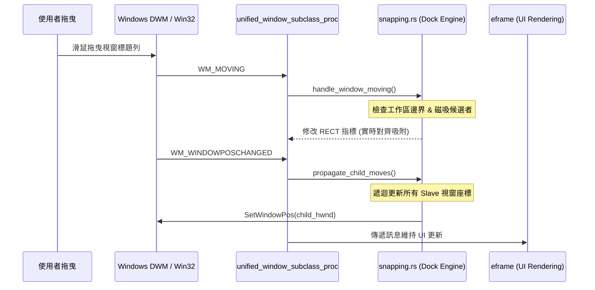

# Win2Pod 視窗磁吸架構設計與踩坑復盤心得

> **作者**：Win2Pod Core Architecture Team  
> **日期**：2026-11-20  
> **標籤**：`Rust` `egui/eframe` `Win32 Subclassing` `Window Snapping` `Dock Tree Forest` `Lessons Learned`

---

## 1. 背景與設計目標

在打造現代音訊串流與播放工具 **Win2Pod** 的過程中，我們希望重現經典播放器（如 **Winamp**）最受玩家喜愛的靈魂功能——**多視窗磁力吸附與叢集一體化聯動（Magnetic Snapping & Docking Cluster）**。

Win2Pod 包含四個獨立用途的視窗：
1. **主控制視窗（Main Window）**：AirPlay 設備管理、設定、系統托盤常駐。
2. **迷你播放器（Mini Player）**：輕巧精緻的懸浮播放器，提供專輯封面、即時波形、VFD 液晶面板與控制鈕。
3. **10 頻段音訊等化器（Audio Equalizer）**：提供 DSP 等化調整、暖音增強與預設切換。
4. **即時視覺特效視窗（Visualizer）**：基於 WebView2 與 WebGL / Three.js 的全螢幕/視窗化 3D 頻譜動畫。

### 核心設計目標
- **自然貼齊（Magnetic Snapping）**：視窗靠近螢幕工作區邊緣、其他視窗邊緣（$\le 12\text{px}$）時產生磁吸咬合。
- **叢集聯動（Group Movement）**：合體為群組後，拖曳主導視窗可帶動所有相吸視窗一體平滑移動。
- **自由拆解（Natural Severance）**：使用者刻意向外拉拽子視窗（位移 $> 16\text{px}$）即可「撕開」磁吸，脫離隊伍獨立自由移動。
- **群組意識與動態子群組（Sub-cluster Autonomy）**：即便主視窗關閉或收至系統匣，桌面上殘留的副視窗（如迷你播放器與等化器）仍能自成體系、持續磁吸並相互帶動。

---

## 2. 磁吸架構演進：從一對一 Hardcode 到「有向擴展樹狀森林」

```mermaid
graph TD
    classDef main fill:#1e3a5f,stroke:#4a9eff,stroke-width:2px;
    classDef mini fill:#2d4a3e,stroke:#5cdb95,stroke-width:2px;
    classDef eq fill:#4a3b2c,stroke:#f39c12,stroke-width:2px;
    classDef vis fill:#3a2d4a,stroke:#9b59b6,stroke-width:2px;

    Main["主視窗 (Lv 1)"]:::main
    Mini["迷你播放器 (Lv 2)"]:::mini
    EQ["等化器視窗 (Lv 3)"]:::eq
    Vis["視覺特效 (Lv 4)"]:::vis

    Main -- "磁吸邊 (Right/Top)" --> Mini
    Mini -- "磁吸邊 (Bottom)" --> EQ
    Main -- "磁吸邊 (Right/Bottom)" --> Vis
```

### 階段一：一對一的死胡同
在最初期，系統只考慮「主視窗」與「視覺化視窗」的吸附，採用單一靜態變數 `DOCK_BOND: Mutex<DockBond>` 來記錄二者的相對偏移。
當引進第三個視窗（等化器）與第四個視窗（迷你播放器）後，狀態維護迅速崩潰：
- 關係從 1 對 1 暴增為多對多無向圖。
- 容易產生**環狀依賴（Cycle Loops）**：A 帶動 B、B 帶動 C、C 又把 A 拖回原點，導致座標振盪或畫面抖動。
- 無法表達「誰聽誰的」：兩個視窗合體時，移動其中一個到底誰該跟隨？

### 階段二：有向無環樹狀森林（Directed Dock Tree Forest）
我們重構為以圖論為基石的**有向無環擴展樹森林架構**：

1. **嚴格優先級層次（Priority Hierarchy）**：
   $$\text{Main (Level 1)} > \text{MiniPlayer (Level 2)} > \text{Equalizer (Level 3)} > \text{Visualizer (Level 4)}$$
2. **單一父節點不變量（Master-Slave Invariant）**：
   - 任何合體的從屬視窗（Slave）在 Dock Tree 中**至多只能有 1 個 Master（父節點）**。
   - 樹的拓撲結構保證是無環的（Directed Acyclic Graph），從數學上徹底消滅死循環。
3. **非對稱拉力（Asymmetric Pull Dynamics）**：
   - **向下擴散（Master $\to$ Slaves）**：當 Master 移動時，透過 `propagate_child_moves` 沿著樹狀分支遞迴更新所有子節點座標。
   - **向上剪枝（Slave $\to$ Master）**：當使用者拖曳 Slave 視窗時，Master **絕不會被帶動**；若位移超過容差門檻（$16\text{px}$），系統判定使用者意圖拆開，立即剪斷該邊（Sever edge）並調用 `rebuild_dock_tree()`。
4. **動態子群組根節點提升（Subcluster Root Promotion）**：
   若主視窗脫離或關閉，殘留在桌面上的副視窗群組會重新進行連通元件分解（Connected Components），由優先權最高者（如 Mini Player）自動升格為該子群組的根節點。

---

## 3. Win32 底層訊息攔截機制

`eframe` / `egui` 本身在跨平台上是定時渲染，無法提供 Windows 原生拖曳過程中的高頻同步。我們使用 Win32 **視窗子類化（Window Subclassing）** 作為核心引擎：

### 關鍵 Win32 訊息職責
- `WM_MOVING`：攔截即將發生的位移矩形指標（`lparam as *mut RECT`），原地修正座標達成即時吸附貼合。
- `WM_WINDOWPOSCHANGED`：當視窗位置確定改變且非縮小，發送 `propagate_child_moves` 帶動整個子樹。
- `WM_EXITSIZEMOVE`：拖曳放手瞬間校驗所有已吸附的邊，若視窗間隙已大於耐受值則斷開連接。
- `WM_MOUSEACTIVATE` / `WM_ACTIVATE`：調用 `bring_cluster_to_top`，透過 `SetWindowPos(top_tier)` 連鎖提升整個群組的 Z-Order，防止視窗夾在其他軟體中間。
- `WM_SYSCOMMAND (SC_CLOSE)`：攔截系統關閉指令，觸發自定義群組連帶關閉（Cluster Close）。

---

## 4. 視窗群組釘選與 Z-Order 管理規範（Window Pinning & Z-Order Specification）

在多視窗磁吸系統中，視窗除了在 $(X, Y)$ 平面上吸附聯動，在 $Z$ 軸深度（Z-Order）與系統置頂層級（Topmost Tier）上也必須具備嚴格的群組一致性。若缺乏體系化約束，容易引發「UI 按鈕顯示未釘選，視窗卻物理常駐最上層」等幽靈置頂現象。

```mermaid
flowchart TD
    classDef ssot fill:#1e3a5f,stroke:#4a9eff,stroke-width:2px;
    classDef top fill:#4a3b2c,stroke:#f39c12,stroke-width:2px;
    classDef notop fill:#2d4a3e,stroke:#5cdb95,stroke-width:2px;

    SSOT["全域原子核心: IS_ALWAYS_ON_TOP (SSOT)"]:::ssot
    UserToggle["使用者點擊 📌 釘選按鈕"] --> SSOT

    SSOT -->|is_pinned = true| PinCluster["set_cluster_pinned(true)"]:::top
    SSOT -->|is_pinned = false| UnpinCluster["set_cluster_pinned(false)"]:::notop

    subgraph TopmostTier ["置頂層級 (WS_EX_TOPMOST)"]
        PinCluster --> HWND_TOPMOST["SetWindowPos(HWND_TOPMOST)"]
        HWND_TOPMOST --> W1["主視窗"]
        HWND_TOPMOST --> W2["迷你播放器"]
        HWND_TOPMOST --> W3["等化器"]
        HWND_TOPMOST --> W4["視覺效果視窗"]
    end

    subgraph NormalTier ["普通層級 (非置頂)"]
        UnpinCluster --> HWND_NOTOPMOST["SetWindowPos(HWND_NOTOPMOST)"]
        HWND_NOTOPMOST -->|徹底清除 WS_EX_TOPMOST 旗標| NW1["全員回歸普通 Z 軸"]
    end
```

### 核心釘選規則體系

#### 規則 1：單一事實來源（Single Source of Truth, SSOT）
- **核心開關統一**：全系統視窗的釘選狀態以全域原子變數 `IS_ALWAYS_ON_TOP` 及 Master 視窗（`FlyoutApp.is_always_on_top`）為最高唯一事實來源。
- **禁止狀態分裂**：歷史設定中個別殘留的子視窗釘選值（如 `visualizer_pinned`）在視窗接入工作站群組時，**強制被 Master 視窗當前的釘選狀態覆寫同化**，嚴禁副視窗持有相衝突的獨立釘選狀態。

#### 規則 2：叢集原子連鎖釘選（Cluster Pin Atomicity）
- **一處釘選，全員置頂（Pin One, Pin All）**：當使用者在 Master 視窗（或任一依附節點）點擊釘選圖釘時，系統調用 `set_cluster_pinned(origin, true)`，沿著 Dock Tree 遍歷所有成員，原子級同步套用 `HWND_TOPMOST`。
- **一處解除，全員解脫（Unpin One, Unpin All）**：解除釘選時，遍歷全員調用 `HWND_NOTOPMOST`，並同步持久化設定。
- **獨立視窗豁免（Standalone Exemption）**：若使用者刻意撕開副視窗獨立使用（例如拉開視覺特效視窗至副螢幕），該視窗才享有獨立的釘選能力；但只要重新吸附回集群，立即同化回集群狀態。

#### 規則 3：Win32 Z-Order 階層降級鐵律（`HWND_NOTOPMOST` 徹底取代 `HWND_TOP`）
- **Win32 API 原生特性**：
  - `HWND_TOPMOST`：賦予視窗 `WS_EX_TOPMOST`，送入置頂層。
  - `HWND_NOTOPMOST`：**唯一能抹除 `WS_EX_TOPMOST`** 並將視窗降回普通層的指令。
  - `HWND_TOP`：僅將視窗移至**其當前所屬層級的頂部**。若視窗已具備置頂樣式，傳入 `HWND_TOP` **完全無法解除置頂**！
- **強制執行標準**：
  在非置頂狀態（`!is_topmost`）下，所有視窗維護動作（包括 `bring_cluster_to_top`、`layout_modular_workstation`、`dock_spawned_window` 滑入動畫、`bring_main_to_front` 托盤喚醒），**一律強制傳入 `HWND_NOTOPMOST`**，堅決封殺任何因使用 `HWND_TOP` 造成的幽靈置頂殘留。

#### 規則 4：主從焦點防護與防逆向感染（Anti-Infection Shield）
- **病因背景**：副視窗（如 WebView2 視覺特效）獲取焦點（`WM_ACTIVATE` / `WM_SETFOCUS`）時，若在訊息迴圈中擅自執行 `SetWindowPos(main_hwnd, HWND_TOPMOST)`，會導致主視窗在 UI 按鈕未點亮的情況下被「暗中感染」為實體最上層。
- **防禦機制**：副視窗只有在處於「全螢幕展示」或「全域 `IS_ALWAYS_ON_TOP == true`」的明確條件下，才允許請求母視窗置頂；非置頂狀態下嚴禁向外傳播 `HWND_TOPMOST`。

#### 規則 5：全螢幕覆蓋特例（Fullscreen Override）
- 當視覺特效進入全螢幕時，自動提升為最上層覆蓋 Windows 工作列；此時若呼叫主控制介面（HUD），主視窗被暫時性提升至全螢幕視覺效果之上以供操作；一旦退出全螢幕，立即自動復原叢集原本的釘選層次。

---

## 5. 關鍵挑戰與深度踩坑復盤（Lessons Learned）

在本次多視窗磁吸架構落地的過程中，我們遭遇了五個極為隱蔽且深度的系統級難題，在此留下寶貴的排查經驗與防範心法：

### 坑點 1：WebView2 COM 物件銷毀重入崩潰（Panic `0xffeaecffffffffff` 與 Exit Code `-1`）
- **現象**：
  在主視窗與視覺特效視窗（WebView2）合體狀態下關閉主視窗，程式有機率發生致命崩潰：
  `FATAL PANIC ... misaligned pointer dereference: address must be a multiple of 0x8 but is 0xffeaecffffffffff`
  或直接以 Exit Code `0xffffffff` 瞬間閃退。
- **深度病因**：
  1. 視覺特效視窗是透過 `wry` 託管的 Edge WebView2。
  2. 當群組觸發 `close_window_cluster` 時，Windows 發送 `WM_CLOSE` 呼叫 `DestroyWindow`。
  3. 但此時 WebView2 內部的 `parent_subclass_proc` 仍在 Win32 訊息隊列中處理消息。
  4. 視窗句柄銷毀與 COM 物件（`ICoreWebView2Controller`）釋放發生微秒級別的競爭，導致已釋放的虛擬方法表指標（VTable）被嘗試解引用（產生負數無效指標 `0xffeaecffffffffff`），觸發 Chromium 底層的 `TerminateProcess(GetCurrentProcess(), -1)`。
- **解法心法**：
  - **切斷通訊在先**：在關閉群組時，第一步永遠是**先解散磁吸關係、切斷視窗間通訊**。
  - **原子鎖保護**：設立 `VISUALIZER_CLOSING` 原子旗標，並在調用銷毀前立刻將 `VISUALIZER_HWND` 歸零，使後續訊息直接由 `DefSubclassProc` 放行，阻斷重複銷毀。

---

### 坑點 2：`eframe` 單幀 Viewport 銷毀陷阱（The 1-Frame Viewport Teardown Trap）
- **現象**：
  拉開迷你播放器後關閉主視窗，迷你播放器沒有關閉（正確），但會**突然瞬間瞬移到螢幕正中央**。
- **深度病因**：
  1. 主視窗點擊 `X` 關閉時，在 [gui.rs](file:///C:/Users/mesme/workspace/win2pod-bridge/crates/homepod-cast-gui/src/gui.rs) 中攔截到 `close_req`，執行了收起群組後直接調用了 **`return;`** 提前退出當前幀的渲染函數。
  2. **`eframe` 的即時視窗生命週期機制**：任何副視窗（`show_viewport_immediate`）如果在**哪怕僅僅一幀**之內沒有被呼叫渲染，`eframe` 就會判定該視窗已不存在，直接呼叫 Win32 `DestroyWindow` 將其原生視窗銷毀！
  3. 下一幀中，由於 `mini_player_window_open` 仍為 true，`eframe` 又重新建立了一個全新的原生視窗。
  4. 新視窗初始化時走入「出生定位（Spawn Position）」邏輯；由於主視窗此時在托盤，無可吸附錨點，系統退回兜底邏輯（Fallback: Screen Center），導致視窗跳回螢幕正中央！
- **解法心法**：
  - **絕對不能在幀循環中無故早退**：移除 `return;`，改由主面板跳過機制（`CentralPanel` 依據 `is_hidden` 條件渲染）讓生命週期無縫延續。只要副視窗在每一幀都持續呼叫 `show_viewport_immediate`，原生 HWND 與座標就能永久固化。

---

### 坑點 3：全域托盤旗標污染副視窗（Global Tray Guard Poisoning）
- **現象**：
  迷你播放器與等化器磁吸合體後關閉主視窗，二者外觀看起來是一體、關閉時也會一併關閉，但是**拖曳迷你播放器時，等化器紋絲不動**。
- **深度病因**：
  1. 主視窗縮小至系統匣時，為了避免它被系統完全關閉，採取將座標移至離屏 `(-32000, -32000)` 的做法。
  2. 為了防止移至 -32000 時誤觸發吸附，開發者在 `unified_window_subclass_proc` 頂端加了一行：
     `if crate::tray::is_window_hidden_to_tray() { return DefSubclassProc(...); }`
  3. **這是一個全域判斷，套用到了所有視窗**！
  4. 當主視窗在托盤時，桌面上存活的迷你播放器和等化器在收到 `WM_MOVING` / `WM_WINDOWPOSCHANGED` 時，全部直接被提早 Return，負責帶動子節點的 `propagate_child_moves` 完全沒機會執行。
- **解法心法**：
  - **護盾必須精準對焦**：將過濾條件改為 `if kind == WindowKind::Main && is_window_hidden_to_tray()`。任何時候都必須意識到「主視窗收進托盤」並不等於「整個應用程式停止運作」，副視窗應享有獨立完整的事件泵。

---

### 坑點 4：吸附（Snap）與脫離（Sever）的滯後容差區間（Hysteresis）
- **現象**：
  若將「吸附距離」與「脫離距離」設定為相同數值（例如均為 12px），使用者在拉扯視窗時，視窗會在「被吸附」與「被脫離」之間高速劇烈跳動（抖動現象）。
- **解法心法**：
  - 引入**遲滯效應（Hysteresis）**：
    - **吸附門檻（Snap Distance）**：$12\text{px}$（只有靠得夠近才吸上去）。
    - **脫離門檻（Sever Distance）**：$16\text{px}$（必須刻意拉開超過 $16\text{px}$ 才會切斷）。
    - 兩者間的 $4\text{px}$ 緩衝區有效保障了手感的安定度。

---

### 坑點 5：Z-Order 狀態脫鉤與「幽靈置頂」逆向感染（Ghost Topmost & Reverse Pin Infection）
- **現象**：
  使用者在程式剛啟動時點擊「打開工作站配置」，標題列上的釘選按鈕呈現未激活的灰色（`is_always_on_top == false`），但所有視窗卻實體頑固浮在桌面最頂層，擋住其他桌面程式；使用者必須按一下釘選鈕（按鈕變金黃色，視窗維持置頂），再按一下（按鈕變灰），全體視窗才真正解除最上層。
- **深度病因（四重因素交織）**：
  1. **設定檔狀態分裂**：系統記錄了 `always_on_top`（主程式）與 `visualizer_pinned`（視覺特效）兩組開關；歷史執行殘留使視覺特效記錄為 `true`，主程式為 `false`。
  2. **副視窗逆向感染母視窗**：工作站組裝時視覺特效視窗啟動，在收到 `WM_ACTIVATE` / `WM_SETFOCUS` 時，因自身 `is_pinned == true` 為了防止擋住母視窗，主動呼叫 `SetWindowPos(main_hwnd, HWND_TOPMOST)`，將主視窗物理升格為置頂視窗。
  3. **集群連帶牽引**：工作站對齊與磁吸群組遍歷時，所有依附視窗順勢被掛在主視窗之後，全員被推入 Topmost Tier。
  4. **Win32 API 原生陷阱**：在非置頂邏輯中，系統原先使用 `top_tier = if is_topmost { HWND_TOPMOST } else { HWND_TOP }`。在 Windows 規範中，**`HWND_TOP` 僅將視窗排至其所屬層次頂部，根本無法剝除 `WS_EX_TOPMOST` 樣式**！只有顯式傳入 `HWND_NOTOPMOST` 才能將置頂視窗降級。
- **解法心法**：
  - **開關嚴格同化（SSOT）**：工作站組裝與視覺特效出生時，釘選狀態強制鎖定為 Master 狀態，禁止雙軌獨立。
  - **阻斷逆向感染**：副視窗只有在全域 `IS_ALWAYS_ON_TOP == true` 時才准許將母視窗提拔為置頂。
  - **全面以 `HWND_NOTOPMOST` 徹底降級**：在非置頂狀態下，全面使用 `HWND_NOTOPMOST` 執行 SetWindowPos，保證原子級剝除幽靈置頂樣式。

---

## 6. 架構核心成果與檢驗

經過此番體系化梳理與重構，Win2Pod 達成如下標準行為：

| 操作情境 | 行為表現 | 核心保證機制 |
| :--- | :--- | :--- |
| **四視窗任意拼裝** | 支援右側排列、頂部拼裝、底部等化器多重組合 | BFS 樹遍歷 + 依賴驗證 |
| **拖曳母視窗** | 全體相連子節點以 60 FPS 幀率鎖定同步移動 | `propagate_child_moves` |
| **拖曳子視窗** | 脫離當前母視窗，母視窗不動，子視窗獨立移出 | `remove_dock_edge` 向上剪枝 |
| **關閉主視窗** | 若副視窗已脫離，副視窗平穩停留在原處且持續連動 | 免早退幀連續性 + 精準托盤防護 |
| **點擊任一合體視窗** | 群組內所有視窗原子級同步置頂，不被第三方視窗穿插 | `bring_cluster_to_top` Z-Order 秩序 |
| **點擊任一合體視窗 📌** | 全叢集視窗原子級同步切換置頂／非置頂，杜絕幽靈置頂 | `set_cluster_pinned` + `HWND_NOTOPMOST` 規範 |
| **點擊任一合體視窗 X** | 連鎖關閉該連通群組中的所有合體視窗 | `close_window_cluster` 遍歷關閉 |

---

## 7. 結語

視窗磁吸吸附表面上看似只是「計算座標貼齊」，但一旦引入**多視窗自由組合、主從聯動、生命週期異步化與跨架構渲染框架（Win32 + egui + wry）**，其複雜度便會呈幾何級數上升。

本次實踐的關鍵體悟在於：
1. **嚴謹的資料結構先行**（樹狀森林與單一父節點約束，徹底杜絕死循環）。
2. **通訊生命週期大於一切**（在視窗銷毀與重繪交界處，精準的狀態原子隔離是防止閃退的不二法門）。
3. **全局狀態需極度克制**（避免全域旗標污染獨立副視窗的事件泵）。
4. **Z 軸與平面享有同等嚴謹的階層規範**（單一事實來源、杜絕狀態分裂與逆向感染，並善用 Win32 `HWND_NOTOPMOST` 清除非預期置頂）。

這份經驗不僅讓 Win2Pod 成功重現經典 Winamp 的迷人操作手感，更為未來進一步擴充更多模組視窗立下了堅實可靠的架構基礎。
