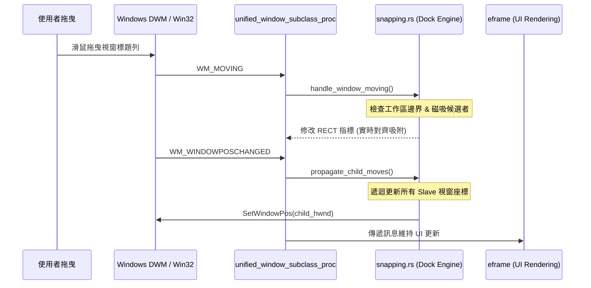
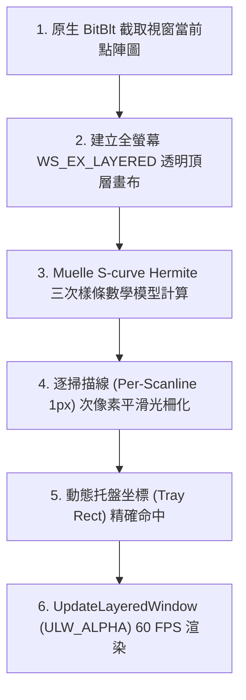
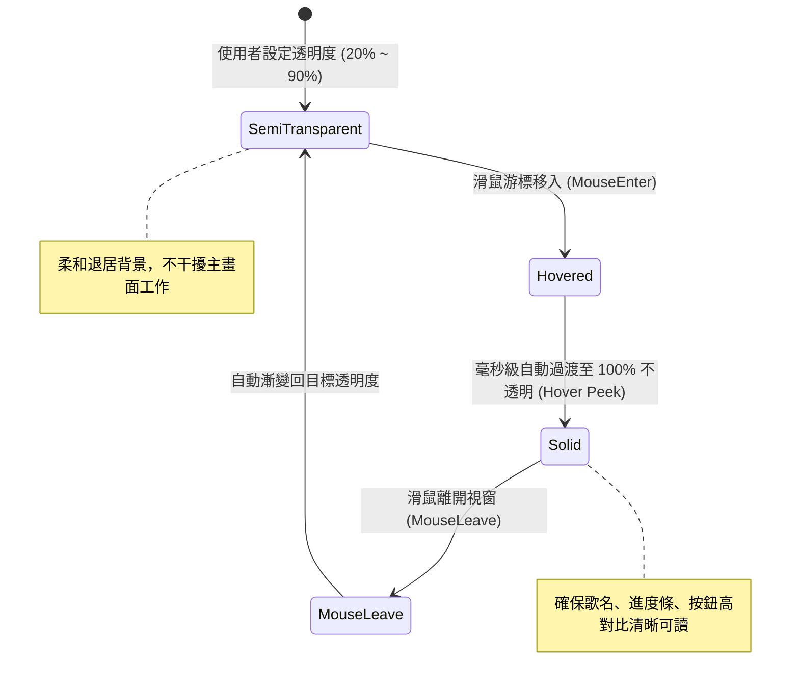
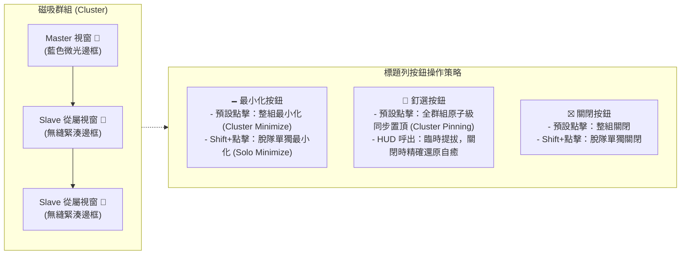
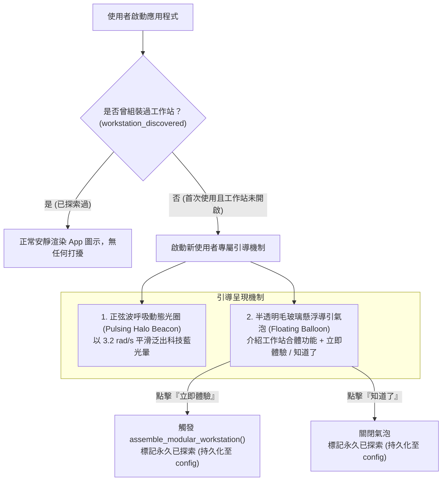
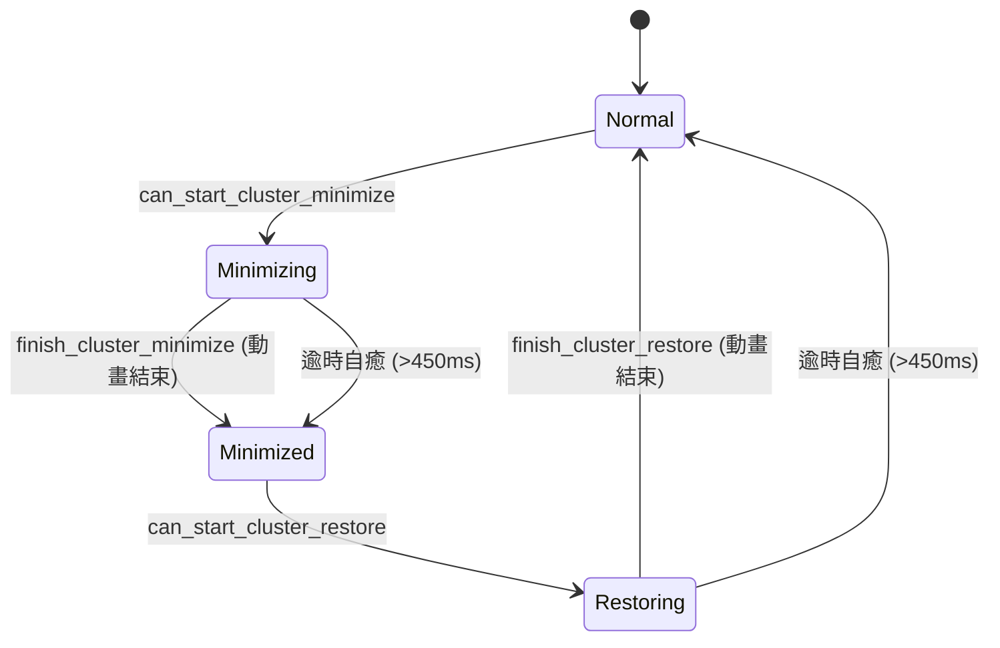
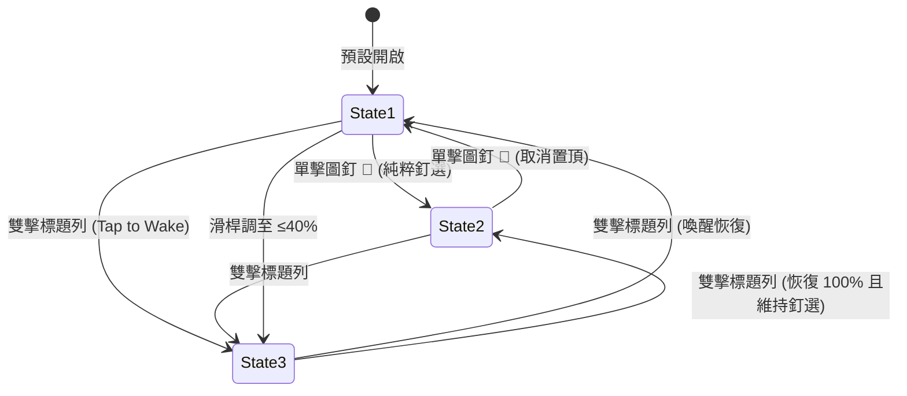

# Win2Pod 視窗磁吸架構設計與踩坑復盤心得

> **作者**：Win2Pod Core Architecture Team  
> **日期**：2026-11-20  
> **標籤**：`Rust` `egui/eframe` `Win32 Subclassing` `Window Snapping` `Dock Tree Forest` `Lessons Learned`

---

## 1. 背景與設計目標

在打造現代音訊串流與播放工具 **Win2Pod** 的過程中，我們希望重現經典播放器（如 **Winamp**）最受玩家喜愛的靈魂功能——**多視窗磁力吸附與叢集一體化聯動（Magnetic Snapping & Docking Cluster）**。

Win2Pod 包含四個獨立用途的視窗：
1. **主控制視窗（Main Window）**：AirPlay 設備管理、設定、系統托盤常駐。
2. **迷你播放器（Mini Player）**：輕巧精緻的懸浮播放器，提供專輯封面、即時波形、VFD 液晶面板與控制鈕。
3. **10 頻段音訊等化器（Audio Equalizer）**：提供 DSP 等化調整、暖音增強與預設切換。
4. **即時視覺特效視窗（Visualizer）**：基於 WebView2 與 WebGL / Three.js 的全螢幕/視窗化 3D 頻譜動畫。

### 核心設計目標
- **自然貼齊（Magnetic Snapping）**：視窗靠近螢幕工作區邊緣、其他視窗邊緣（$\le 12\text{px}$）時產生磁吸咬合。
- **叢集聯動（Group Movement）**：合體為群組後，拖曳主導視窗可帶動所有相吸視窗一體平滑移動。
- **自由拆解（Natural Severance）**：使用者刻意向外拉拽子視窗（位移 $> 16\text{px}$）即可「撕開」磁吸，脫離隊伍獨立自由移動。
- **群組意識與動態子群組（Sub-cluster Autonomy）**：即便主視窗關閉或收至系統匣，桌面上殘留的副視窗（如迷你播放器與等化器）仍能自成體系、持續磁吸並相互帶動。

---

## 2. 磁吸架構演進：從一對一 Hardcode 到「有向擴展樹狀森林」

```mermaid
graph TD
    classDef main fill:#1e3a5f,stroke:#4a9eff,stroke-width:2px;
    classDef mini fill:#2d4a3e,stroke:#5cdb95,stroke-width:2px;
    classDef eq fill:#4a3b2c,stroke:#f39c12,stroke-width:2px;
    classDef vis fill:#3a2d4a,stroke:#9b59b6,stroke-width:2px;

    Main["主視窗 (Lv 1)"]:::main
    Mini["迷你播放器 (Lv 2)"]:::mini
    EQ["等化器視窗 (Lv 3)"]:::eq
    Vis["視覺特效 (Lv 4)"]:::vis

    Main -- "磁吸邊 (Right/Top)" --> Mini
    Mini -- "磁吸邊 (Bottom)" --> EQ
    Main -- "磁吸邊 (Right/Bottom)" --> Vis
```



### 階段一：一對一的死胡同
在最初期，系統只考慮「主視窗」與「視覺化視窗」的吸附，採用單一靜態變數 `DOCK_BOND: Mutex<DockBond>` 來記錄二者的相對偏移。
當引進第三個視窗（等化器）與第四個視窗（迷你播放器）後，狀態維護迅速崩潰：
- 關係從 1 對 1 暴增為多對多無向圖。
- 容易產生**環狀依賴（Cycle Loops）**：A 帶動 B、B 帶動 C、C 又把 A 拖回原點，導致座標振盪或畫面抖動。
- 無法表達「誰聽誰的」：兩個視窗合體時，移動其中一個到底誰該跟隨？

### 階段二：有向無環樹狀森林（Directed Dock Tree Forest）
我們重構為以圖論為基石的**有向無環擴展樹森林架構**：

1. **嚴格優先級層次（Priority Hierarchy）**：
   $$\text{Main (Level 1)} > \text{MiniPlayer (Level 2)} > \text{Equalizer (Level 3)} > \text{Visualizer (Level 4)}$$
2. **單一父節點不變量（Master-Slave Invariant）**：
   - 任何合體的從屬視窗（Slave）在 Dock Tree 中**至多只能有 1 個 Master（父節點）**。
   - 樹的拓撲結構保證是無環的（Directed Acyclic Graph），從數學上徹底消滅死循環。
3. **非對稱拉力（Asymmetric Pull Dynamics）**：
   - **向下擴散（Master $\to$ Slaves）**：當 Master 移動時，透過 `propagate_child_moves` 沿著樹狀分支遞迴更新所有子節點座標。
   - **向上剪枝（Slave $\to$ Master）**：當使用者拖曳 Slave 視窗時，Master **絕不會被帶動**；若位移超過容差門檻（$16\text{px}$），系統判定使用者意圖拆開，立即剪斷該邊（Sever edge）並調用 `rebuild_dock_tree()`。
4. **動態子群組根節點提升（Subcluster Root Promotion）**：
   若主視窗脫離或關閉，殘留在桌面上的副視窗群組會重新進行連通元件分解（Connected Components），由優先權最高者（如 Mini Player）自動升格為該子群組的根節點。

---

## 3. Win32 底層訊息攔截機制

`eframe` / `egui` 本身在跨平台上是定時渲染，無法提供 Windows 原生拖曳過程中的高頻同步。我們使用 Win32 **視窗子類化（Window Subclassing）** 作為核心引擎：



### 關鍵 Win32 訊息職責
- `WM_MOVING`：攔截即將發生的位移矩形指標（`lparam as *mut RECT`），原地修正座標達成即時吸附貼合。
- `WM_WINDOWPOSCHANGED`：當視窗位置確定改變且非縮小，發送 `propagate_child_moves` 帶動整個子樹。
- `WM_EXITSIZEMOVE`：拖曳放手瞬間校驗所有已吸附的邊，若視窗間隙已大於耐受值則斷開連接。
- `WM_MOUSEACTIVATE` / `WM_ACTIVATE`：調用 `bring_cluster_to_top`，透過 `SetWindowPos(top_tier)` 連鎖提升整個群組的 Z-Order，防止視窗夾在其他軟體中間。
- `WM_SYSCOMMAND (SC_CLOSE)`：攔截系統關閉指令，觸發自定義群組連帶關閉（Cluster Close）。

---

## 4. 視窗群組釘選與 Z-Order 管理規範（Window Pinning & Z-Order Specification）

在多視窗磁吸系統中，視窗除了在 $(X, Y)$ 平面上吸附聯動，在 $Z$ 軸深度（Z-Order）與系統置頂層級（Topmost Tier）上也必須具備嚴格的群組一致性。若缺乏體系化約束，容易引發「UI 按鈕顯示未釘選，視窗卻物理常駐最上層」等幽靈置頂現象。

```mermaid
flowchart TD
    classDef ssot fill:#1e3a5f,stroke:#4a9eff,stroke-width:2px;
    classDef top fill:#4a3b2c,stroke:#f39c12,stroke-width:2px;
    classDef notop fill:#2d4a3e,stroke:#5cdb95,stroke-width:2px;

    SSOT["全域原子核心: IS_ALWAYS_ON_TOP (SSOT)"]:::ssot
    UserToggle["使用者點擊 📌 釘選按鈕"] --> SSOT

    SSOT -->|is_pinned = true| PinCluster["set_cluster_pinned(true)"]:::top
    SSOT -->|is_pinned = false| UnpinCluster["set_cluster_pinned(false)"]:::notop

    subgraph TopmostTier ["置頂層級 (WS_EX_TOPMOST)"]
        PinCluster --> HWND_TOPMOST["SetWindowPos(HWND_TOPMOST)"]
        HWND_TOPMOST --> W1["主視窗"]
        HWND_TOPMOST --> W2["迷你播放器"]
        HWND_TOPMOST --> W3["等化器"]
        HWND_TOPMOST --> W4["視覺效果視窗"]
    end

    subgraph NormalTier ["普通層級 (非置頂)"]
        UnpinCluster --> HWND_NOTOPMOST["SetWindowPos(HWND_NOTOPMOST)"]
        HWND_NOTOPMOST -->|徹底清除 WS_EX_TOPMOST 旗標| NW1["全員回歸普通 Z 軸"]
    end
```



### 核心釘選規則體系

#### 規則 1：單一事實來源（Single Source of Truth, SSOT）
- **核心開關統一**：全系統視窗的釘選狀態以全域原子變數 `IS_ALWAYS_ON_TOP` 及 Master 視窗（`FlyoutApp.is_always_on_top`）為最高唯一事實來源。
- **禁止狀態分裂**：歷史設定中個別殘留的子視窗釘選值（如 `visualizer_pinned`）在視窗接入工作站群組時，**強制被 Master 視窗當前的釘選狀態覆寫同化**，嚴禁副視窗持有相衝突的獨立釘選狀態。

#### 規則 2：叢集原子連鎖釘選（Cluster Pin Atomicity）
- **一處釘選，全員置頂（Pin One, Pin All）**：當使用者在 Master 視窗（或任一依附節點）點擊釘選圖釘時，系統調用 `set_cluster_pinned(origin, true)`，沿著 Dock Tree 遍歷所有成員，原子級同步套用 `HWND_TOPMOST`。
- **一處解除，全員解脫（Unpin One, Unpin All）**：解除釘選時，遍歷全員調用 `HWND_NOTOPMOST`，並同步持久化設定。
- **獨立視窗豁免（Standalone Exemption）**：若使用者刻意撕開副視窗獨立使用（例如拉開視覺特效視窗至副螢幕），該視窗才享有獨立的釘選能力；但只要重新吸附回集群，立即同化回集群狀態。

#### 規則 3：Win32 Z-Order 階層降級鐵律（`HWND_NOTOPMOST` 徹底取代 `HWND_TOP`）
- **Win32 API 原生特性**：
  - `HWND_TOPMOST`：賦予視窗 `WS_EX_TOPMOST`，送入置頂層。
  - `HWND_NOTOPMOST`：**唯一能抹除 `WS_EX_TOPMOST`** 並將視窗降回普通層的指令。
  - `HWND_TOP`：僅將視窗移至**其當前所屬層級的頂部**。若視窗已具備置頂樣式，傳入 `HWND_TOP` **完全無法解除置頂**！
- **強制執行標準**：
  在非置頂狀態（`!is_topmost`）下，所有視窗維護動作（包括 `bring_cluster_to_top`、`layout_modular_workstation`、`dock_spawned_window` 滑入動畫、`bring_main_to_front` 托盤喚醒），**一律強制傳入 `HWND_NOTOPMOST`**，堅決封殺任何因使用 `HWND_TOP` 造成的幽靈置頂殘留。

#### 規則 4：主從焦點防護與防逆向感染（Anti-Infection Shield）
- **病因背景**：副視窗（如 WebView2 視覺特效）獲取焦點（`WM_ACTIVATE` / `WM_SETFOCUS`）時，若在訊息迴圈中擅自執行 `SetWindowPos(main_hwnd, HWND_TOPMOST)`，會導致主視窗在 UI 按鈕未點亮的情況下被「暗中感染」為實體最上層。
- **防禦機制**：副視窗只有在處於「全螢幕展示」或「全域 `IS_ALWAYS_ON_TOP == true`」的明確條件下，才允許請求母視窗置頂；非置頂狀態下嚴禁向外傳播 `HWND_TOPMOST`。

#### 規則 5：全螢幕覆蓋特例（Fullscreen Override）
- 當視覺特效進入全螢幕時，自動提升為最上層覆蓋 Windows 工作列；此時若呼叫主控制介面（HUD），主視窗被暫時性提升至全螢幕視覺效果之上以供操作；一旦退出全螢幕，立即自動復原叢集原本的釘選層次。

---

## 5. 關鍵挑戰與深度踩坑復盤（Lessons Learned）

在本次多視窗磁吸架構落地的過程中，我們遭遇了五個極為隱蔽且深度的系統級難題，在此留下寶貴的排查經驗與防範心法：

### 坑點 1：WebView2 COM 物件銷毀重入崩潰（Panic `0xffeaecffffffffff` 與 Exit Code `-1`）
- **現象**：
  在主視窗與視覺特效視窗（WebView2）合體狀態下關閉主視窗，程式有機率發生致命崩潰：
  `FATAL PANIC ... misaligned pointer dereference: address must be a multiple of 0x8 but is 0xffeaecffffffffff`
  或直接以 Exit Code `0xffffffff` 瞬間閃退。
- **深度病因**：
  1. 視覺特效視窗是透過 `wry` 託管的 Edge WebView2。
  2. 當群組觸發 `close_window_cluster` 時，Windows 發送 `WM_CLOSE` 呼叫 `DestroyWindow`。
  3. 但此時 WebView2 內部的 `parent_subclass_proc` 仍在 Win32 訊息隊列中處理消息。
  4. 視窗句柄銷毀與 COM 物件（`ICoreWebView2Controller`）釋放發生微秒級別的競爭，導致已釋放的虛擬方法表指標（VTable）被嘗試解引用（產生負數無效指標 `0xffeaecffffffffff`），觸發 Chromium 底層的 `TerminateProcess(GetCurrentProcess(), -1)`。
- **解法心法**：
  - **切斷通訊在先**：在關閉群組時，第一步永遠是**先解散磁吸關係、切斷視窗間通訊**。
  - **原子鎖保護**：設立 `VISUALIZER_CLOSING` 原子旗標，並在調用銷毀前立刻將 `VISUALIZER_HWND` 歸零，使後續訊息直接由 `DefSubclassProc` 放行，阻斷重複銷毀。

---

### 坑點 2：`eframe` 單幀 Viewport 銷毀陷阱（The 1-Frame Viewport Teardown Trap）
- **現象**：
  拉開迷你播放器後關閉主視窗，迷你播放器沒有關閉（正確），但會**突然瞬間瞬移到螢幕正中央**。
- **深度病因**：
  1. 主視窗點擊 `X` 關閉時，在 [gui.rs](file:///C:/Users/mesme/workspace/win2pod-bridge/crates/homepod-cast-gui/src/gui.rs) 中攔截到 `close_req`，執行了收起群組後直接調用了 **`return;`** 提前退出當前幀的渲染函數。
  2. **`eframe` 的即時視窗生命週期機制**：任何副視窗（`show_viewport_immediate`）如果在**哪怕僅僅一幀**之內沒有被呼叫渲染，`eframe` 就會判定該視窗已不存在，直接呼叫 Win32 `DestroyWindow` 將其原生視窗銷毀！
  3. 下一幀中，由於 `mini_player_window_open` 仍為 true，`eframe` 又重新建立了一個全新的原生視窗。
  4. 新視窗初始化時走入「出生定位（Spawn Position）」邏輯；由於主視窗此時在托盤，無可吸附錨點，系統退回兜底邏輯（Fallback: Screen Center），導致視窗跳回螢幕正中央！
- **解法心法**：
  - **絕對不能在幀循環中無故早退**：移除 `return;`，改由主面板跳過機制（`CentralPanel` 依據 `is_hidden` 條件渲染）讓生命週期無縫延續。只要副視窗在每一幀都持續呼叫 `show_viewport_immediate`，原生 HWND 與座標就能永久固化。

---

### 坑點 3：全域托盤旗標污染副視窗（Global Tray Guard Poisoning）
- **現象**：
  迷你播放器與等化器磁吸合體後關閉主視窗，二者外觀看起來是一體、關閉時也會一併關閉，但是**拖曳迷你播放器時，等化器紋絲不動**。
- **深度病因**：
  1. 主視窗縮小至系統匣時，為了避免它被系統完全關閉，採取將座標移至離屏 `(-32000, -32000)` 的做法。
  2. 為了防止移至 -32000 時誤觸發吸附，開發者在 `unified_window_subclass_proc` 頂端加了一行：
     `if crate::tray::is_window_hidden_to_tray() { return DefSubclassProc(...); }`
  3. **這是一個全域判斷，套用到了所有視窗**！
  4. 當主視窗在托盤時，桌面上存活的迷你播放器和等化器在收到 `WM_MOVING` / `WM_WINDOWPOSCHANGED` 時，全部直接被提早 Return，負責帶動子節點的 `propagate_child_moves` 完全沒機會執行。
- **解法心法**：
  - **護盾必須精準對焦**：將過濾條件改為 `if kind == WindowKind::Main && is_window_hidden_to_tray()`。任何時候都必須意識到「主視窗收進托盤」並不等於「整個應用程式停止運作」，副視窗應享有獨立完整的事件泵。

---

### 坑點 4：吸附（Snap）與脫離（Sever）的滯後容差區間（Hysteresis）
- **現象**：
  若將「吸附距離」與「脫離距離」設定為相同數值（例如均為 12px），使用者在拉扯視窗時，視窗會在「被吸附」與「被脫離」之間高速劇烈跳動（抖動現象）。
- **解法心法**：
  - 引入**遲滯效應（Hysteresis）**：
    - **吸附門檻（Snap Distance）**：$12\text{px}$（只有靠得夠近才吸上去）。
    - **脫離門檻（Sever Distance）**：$16\text{px}$（必須刻意拉開超過 $16\text{px}$ 才會切斷）。
    - 兩者間的 $4\text{px}$ 緩衝區有效保障了手感的安定度。

---

### 坑點 5：Z-Order 狀態脫鉤與「幽靈置頂」逆向感染（Ghost Topmost & Reverse Pin Infection）
- **現象**：
  使用者在程式剛啟動時點擊「打開工作站配置」，標題列上的釘選按鈕呈現未激活的灰色（`is_always_on_top == false`），但所有視窗卻實體頑固浮在桌面最頂層，擋住其他桌面程式；使用者必須按一下釘選鈕（按鈕變金黃色，視窗維持置頂），再按一下（按鈕變灰），全體視窗才真正解除最上層。
- **深度病因（四重因素交織）**：
  1. **設定檔狀態分裂**：系統記錄了 `always_on_top`（主程式）與 `visualizer_pinned`（視覺特效）兩組開關；歷史執行殘留使視覺特效記錄為 `true`，主程式為 `false`。
  2. **副視窗逆向感染母視窗**：工作站組裝時視覺特效視窗啟動，在收到 `WM_ACTIVATE` / `WM_SETFOCUS` 時，因自身 `is_pinned == true` 為了防止擋住母視窗，主動呼叫 `SetWindowPos(main_hwnd, HWND_TOPMOST)`，將主視窗物理升格為置頂視窗。
  3. **集群連帶牽引**：工作站對齊與磁吸群組遍歷時，所有依附視窗順勢被掛在主視窗之後，全員被推入 Topmost Tier。
  4. **Win32 API 原生陷阱**：在非置頂邏輯中，系統原先使用 `top_tier = if is_topmost { HWND_TOPMOST } else { HWND_TOP }`。在 Windows 規範中，**`HWND_TOP` 僅將視窗排至其所屬層次頂部，根本無法剝除 `WS_EX_TOPMOST` 樣式**！只有顯式傳入 `HWND_NOTOPMOST` 才能將置頂視窗降級。
- **解法心法**：
  - **開關嚴格同化（SSOT）**：工作站組裝與視覺特效出生時，釘選狀態強制鎖定為 Master 狀態，禁止雙軌獨立。
  - **阻斷逆向感染**：副視窗只有在全域 `IS_ALWAYS_ON_TOP == true` 時才准許將母視窗提拔為置頂。
  - **全面以 `HWND_NOTOPMOST` 徹底降級**：在非置頂狀態下，全面使用 `HWND_NOTOPMOST` 執行 SetWindowPos，保證原子級剝除幽靈置頂樣式。

---

### 坑點 6：歷史遺留雙視窗硬編碼引發的「跨群組遠程幽靈吸引」（Cross-Cluster Ghost Attraction & Home Summon Severance）
- **現象**：
  在工作站群組拆分後，桌面由「迷你播放器 + 迷你等化器 + 視覺視窗」三者組成一個相吸群組，主視窗處於系統匣隱藏中。當使用者在**迷你播放器**上點擊「🏠（Home 房子按鈕）」希望召喚主視窗合體時，主視窗現身的一瞬間，**視覺視窗竟然如同被磁鐵吸住一般瞬間脫離原群組、被強行吸引到了主視窗身邊**，並與主視窗結合成獨立的一組；而迷你播放器和等化器則被孤立留在原處。
- **深度病因（歷史遺留代碼引發的拓撲撕裂）**：
  1. 在系統早期僅有「主視窗」與「視覺化視窗」雙視窗架構時，開發者在 `tray.rs` 的 `bring_main_to_front()` 尾端加入了一段「還原對齊視覺視窗」的邏輯：
     ```rust
     let bond = crate::snapping::get_dock_bond();
     if bond.is_bonded && !vis_hwnd.is_null() ... {
         let (new_vis_x, new_vis_y) = calc_bonded_visualizer_pos(&bond, &vis_rect, &main_rect);
         SetWindowPos(vis_hwnd, hwnd, new_vis_x, new_vis_y, 0, 0, SWP_NOSIZE | SWP_NOACTIVATE);
     }
     ```
  2. **盲目假設父節點必定為主視窗**：這段代碼僅僅檢查了 `bond.is_bonded == true`，**完全沒有校驗 `bond.parent == WindowKind::Main`**！
  3. 當視覺視窗是吸附在迷你播放器身上時，其 `is_bonded` 亦為 `true`（但母節點為 `MiniPlayer`）。當主視窗從托盤現身時，這段代碼將主視窗舊坐標作為 `master_rect` 傳入，瞬間強制以 `SetWindowPos` 將視覺視窗拉移數百像素至主視窗身側。
  4. 視覺視窗瞬間移位導致其與迷你播放器之間的物理間隔遠大於 24px，在緊接著觸發的 `rebuild_dock_tree()` 中，間隔過大的邊被依法剔除，視覺視窗正式與原群組決裂，轉而與主視窗結為新組。
- **解法心法**：
  - **杜絕任何繞過圖論引擎的私自移位**：現代的擴展樹森林（Dock Tree Forest）已由 `bring_fleet_to_top()` 中的 `restore_and_realign_all_children` 根據嚴密的母子拓撲統一維護。徹底刪除 `tray.rs` 中私自搬移視窗的遺留代碼。
  - **召喚加入以發起者（Anchor Kind）為基準**：主視窗受召喚現身時，本身只是一塊「等待加入群組」的新圖元，絕不能在抵達目標群組前擅自動搖桌面上任何現存視窗的位移。

---

### 坑點 7：全螢幕退出時的「主視窗殭屍復活」（Zombie Resuscitation on Fullscreen Exit）
- **現象**：
  使用者在視覺特效全螢幕模式下呼出 HUD 並點擊了主視窗的 ⛝（關閉／隱藏至系統匣）；然而當按下 `F` 或 `Escape` 切換退出全螢幕回到普通視窗時，**原本已收納至系統匣的主視窗竟然又神秘地自動彈回桌面**！
- **深度病因（全螢幕退出回調中的過度熱心）**：
  1. 在 `visualizer.rs` 的 `toggle_visualizer_fullscreen` 退出分支中，早期開發者為了確保使用者切回視窗化時能看到控制介面，寫了一段防護：
     ```rust
     if crate::tray::is_window_hidden_to_tray() {
         crate::tray::bring_main_to_front();
     } else {
         crate::snapping::bring_fleet_to_top();
     }
     ```
  2. **嚴重忽視使用者在全螢幕下主動關閉主視窗的意志**：當使用者在全螢幕中刻意關閉主視窗，主視窗已合法收合至托盤（`is_window_hidden_to_tray() == true`）。
  3. 一旦退出全螢幕，這段過時的邏輯看到 `is_window_hidden_to_tray() == true`，竟擅自調用 `bring_main_to_front()` 強制將主視窗從 `(-32000, -32000)` 離屏坐標抓回螢幕中央並還原視窗！
- **解法心法**：
  - **尊重使用者的隱藏意志，全面交由 `bring_fleet_to_top()` 統一過濾**：
    刪除強行喚醒邏輯，統一呼叫 `bring_fleet_to_top()`。在 `bring_fleet_to_top()` 內部已具備嚴密的托盤守衛：
    ```rust
    if kind == WindowKind::Main && crate::tray::is_window_hidden_to_tray() {
        continue; // 隱藏於托盤的主視窗老老實實留於托盤，絕不驚擾
    }
    ```
  - 確保視覺特效視窗切回普通模式時，僅調整自身樣式與可見視窗的層級，主視窗維持使用者所期望的隱藏狀態。

---

## 6. 極致視覺體驗：Mac 風格 Muelle Genie S-Curve 神燈最小化效果實踐

除了視窗間的剛性磁吸與聯動，視窗在隱藏與還原時的過渡動畫直接決定了應用的工藝質感。我們在 Windows 平台上以純 Win32 GDI + Layered Window 成功復刻了 macOS 最具辨識度的經典特效——**Muelle Genie Effect（阿拉丁神燈 S 曲線漏斗收縮動畫）**。



### 演進與技術攻堅復盤

#### 1. 拒絕粗糙階梯：從分塊 StretchBlt 到逐掃描線次像素光柵化
- **問題**：早期嘗試將視窗縱向切成 60 塊長條矩形執行 `StretchBlt`，在動畫播放時會出現明顯的「階梯狀橫條拉絲」與鋸齒斷層，完全喪失流體美感。
- **解法**：捨棄逐塊拉伸，改採 **逐掃描線（Per-Scanline 1px）次像素抗鋸齒平滑光柵化**（詳見 [genie_effect.rs](file:///C:/Users/mesme/workspace/win2pod-bridge/crates/homepod-cast-gui/src/genie_effect.rs)）：
  - 建立 32 位元預乘 Alpha DIBSection（`BI_RGB` 32bpp）。
  - 對畫布每一行掃描線（Y 坐標），精確計算 S 曲線的左右邊界邊緣 $[x_{\text{left}}, x_{\text{right}}]$。
  - 透過水平非線性縮放公式，將原始截圖像素平滑對應並線性混合同步寫入記憶體，徹底消除所有鋸齒與階梯感。

#### 2. Muelle S-Curve 數學模型
採用 macOS 經典的 Hermite 曲線模型，根據動畫進度 $t \in [0, 1]$ 與垂直位置 $u \in [0, 1]$ 計算漏斗形狀：
$$S(t) = 3t^2 - 2t^3$$
$$w(u) = (1 - u) \cdot W_{\text{orig}} + u \cdot W_{\text{tray}}$$
在收斂至托盤目標時，底部以優雅的指數收斂曲線逐漸緊貼托盤圖示中心點，形成拉絲漏斗般的流體視覺。

#### 3. 系統匣目標座標精準鎖定
- **問題**：Windows 系統工作列常駐眾多圖示（電池、網路、音量、自訂程式），早期粗略定位容易偏移至相鄰的電池膠囊或時鐘。
- **解法**：在 [tray.rs](file:///C:/Users/mesme/workspace/win2pod-bridge/crates/homepod-cast-gui/src/tray.rs) 中利用 `tray_icon.rect()` 即時獲取自身圖示的物理螢幕 Rect，將神燈漏斗的收縮終點精確綁定在 Win2Pod 圖示的幾何中心點，達成「自圖示中流出、吸回圖示中隱沒」的一體化沉浸感。

---

## 7. 靈動懸浮：視窗原生半透明化（Layered Opacity）與懸浮智慧窺視（Hover Peek）

在多視窗工作站生態中，「迷你播放器」與「視覺特效視窗」常被使用者長時間置頂於螢幕一隅，一邊寫代碼或瀏覽網頁、一邊享受背景音樂與律動。然而，全不透明的視窗會遮蔽後方的編輯器文字，而固定半透明又會導致想看清歌曲或操作按鈕時閱讀困難。

我們為此量身打造了**「原生層疊半透明 + 智慧懸浮窺視（Hover Peek）」**雙軌機制：



### 關鍵機制與技術細節

#### 1. Win32 原生 `WS_EX_LAYERED` 硬體加速混合
- 在 [snapping.rs](file:///C:/Users/mesme/workspace/win2pod-bridge/crates/homepod-cast-gui/src/snapping.rs#L107-L135) 中實作 `apply_native_window_opacity(hwnd, opacity)`：
  - 透過 `GetWindowLongW` / `SetWindowLongW` 附加 `WS_EX_LAYERED` 延伸樣式。
  - 呼叫 Win32 原生 API `SetLayeredWindowAttributes(hwnd, 0, alpha, LWA_ALPHA)`，由 Windows DWM 桌面視窗管理員在 GPU 合成階段以零 CPU 開銷完成 Alpha 混合。
- **性能優化（動態樣式剝除）**：
  當透明度為 $100\%$（`opacity >= 0.999`）時，系統主動以 `SetWindowLongW` 剝除 `WS_EX_LAYERED` 樣式並觸發 `SWP_FRAMECHANGED`，使視窗完整回退至標準原生渲染通道，完全避免分層視窗帶來的微量記憶體與 DWM 轉譯開銷。

#### 2. 安全下限不變量（Safety Clamping Invariant: 20% ~ 100%）
- **踩坑點**：若允許透明度一路降至 $0\%$，視窗會在畫面上徹底「人間蒸發」。使用者既看不見也無法點擊，會誤以為程式崩潰或丟失視窗。
- **架構規範**：嚴格強制夾取（Clamp）透明度區間在 $[0.20, 1.00]$。最低 $20\%$ 保證了在任何暗色或淺色桌布上，視窗輪廓與圖示始終隱約可辨，絕不丟失。

#### 3. 智慧懸浮窺視（Hover Peek / Intelligent Auto-Reveal）
- 在 [visualizer.rs](file:///C:/Users/mesme/workspace/win2pod-bridge/crates/homepod-cast-gui/src/visualizer.rs#L535-L560) 與迷你播放器中：
  - 平時維持安靜半透明（例如 $40\%$），宛如毛玻璃雕刻般懸浮於背景。
  - 只要使用者的滑鼠游標掠過或移入視窗範圍（Hover），系統立刻無感切換至 $100\%$ 不透明，所有歌詞、曲名、光柱與按鈕瞬間立體飽滿；移出後無痕還原，兼顧工作專注與操作便利。

#### 4. Alt + 滑鼠滾輪無級微調（Fast Gesture Tuning）
- 使用者無需深入層層設定選單，只要游標懸浮在迷你播放器或視覺視窗上，按住鍵盤 `Alt` 鍵並滾動滑鼠滾輪，即可即時以 $5\%$ 步進流暢升降透明度，手感極度直覺。

#### 5. 叢集同化與設定持久化
- 每個視窗的半透明數值（`mini_player_opacity`, `visualizer_opacity`）與 Hover Peek 開關（`hover_peek_enabled`）皆寫入設定檔（`controller.rs`）。
- 當副視窗組裝吸附至群組時（`assimilate_cluster_to_anchor`），視窗的樣式狀態會平滑調和，重啟後亦能百分之百原樣復原。

---

## 8. 分工明確的標題列控制：視窗角色徽章、叢集釘選與單獨脫隊最小化（Cluster vs Solo Controls）

在多個視窗合體為一個大叢集時，若每個視窗都保留各自的「🗕 最小化、📌 置頂、⛝ 關閉」，會引發嚴重的操作認知混亂：
- 使用者點擊附屬視窗的 🗕，到底該收起自己、還是收起整組？
- 點擊 📌 釘選，附屬視窗置頂了、但母視窗在底下，視窗會不會被其他外部程式夾在中間「切成千層糕」？

我們為此重構了**「視窗角色自適應與標題列按鈕動態分工」**機制：



### 關鍵機制與技術細節

#### 1. 三態視窗角色（WindowRole）與動態標題列適配
在 [snapping.rs](file:///C:/Users/mesme/workspace/win2pod-bridge/crates/homepod-cast-gui/src/snapping.rs#L435-L460) 中定義三種角色：
- **`WindowRole::ClusterMaster`（叢集母艦 🧲）**：
  - 角色：圖論連通分量中優先權最高（Level 1）的根節點。
  - 外觀：標題列顯示「🧲」徽章，四周帶有 `rgb(70, 140, 215)` 的科技藍主控微光邊框。
  - 職責：擁有全套控制權，掌管全群組的移動、置頂、收納與關閉。
- **`WindowRole::ClusterSlave`（從屬僚機 📎）**：
  - 角色：依附於 Master 之後的子節點。
  - 外觀：標題列顯示「📎」吸附徽章，邊框轉為緊湊暗色 `rgb(45, 50, 60)`。
  - **標題列動態精簡（`set_window_caption_buttons`）**：在 [snapping.rs](file:///C:/Users/mesme/workspace/win2pod-bridge/crates/homepod-cast-gui/src/snapping.rs#L947) 中，系統為 Slave 視窗自動精簡或隱藏重複的系統按鈕，避免畫面雜亂。
- **`WindowRole::Standalone`（獨立個體）**：
  - 未與任何人吸附，外框呈標準中性灰 `rgb(52, 58, 70)`，標題列無徽章，擁有標準單視窗控制邏輯。

#### 2. 最小化按鈕雙模態：全體進退 vs 單獨脫隊
- **預設點擊 🗕（Cluster Minimize）**：
  - 當使用者點擊群組視窗上的最小化按鈕時，系統透過圖論遞迴遍歷整個連通塊，將全員一併收縮最小化，確保工作站整體狀態不被破壞。
- **Shift + 點擊 🗕（Solo Minimize）**：
  - 使用者情境：只想暫時收起「視覺特效」或「等化器」，留下「迷你播放器」繼續聽歌。
  - 實現邏輯（[snapping.rs](file:///C:/Users/mesme/workspace/win2pod-bridge/crates/homepod-cast-gui/src/snapping.rs#L1740-L1760) `minimize_window_solo`）：
    1. 主動調用 `break_dock_relation(target)`，乾淨俐落地將該視窗從有向樹中剪斷（Sever edge）。
    2. 調用 Win32 `ShowWindow(hwnd, SW_MINIMIZE)` 僅最小化該視窗。
    3. 留在桌面上的其餘視窗毫髮無損，系統自動觸發 `rebuild_dock_tree()` 重新推舉剩餘群組的 Master，完成無縫自治過渡。

#### 3. 釘選置頂原子級全域傳播（Cluster Pinning Propagation）
- **核心痛點**：Windows 作業系統底層並不知曉「視窗群組」概念。若群組中有的視窗是 `HWND_TOPMOST`，有的不是，當使用者切換至第三方瀏覽器時，非置頂視窗會被沉入瀏覽器背後，而置頂視窗仍浮在前方，群組實體被「橫向攔腰切斷」。
- **解法心法**：
  - 在 [snapping.rs](file:///C:/Users/mesme/workspace/win2pod-bridge/crates/homepod-cast-gui/src/snapping.rs#L165-L220) 中實作 `toggle_window_pinned(origin)`：
  - 點擊任一合體視窗的 📌 釘選按鈕時，系統取得該群組全體成員，**原子級連帶將全員同步設為置頂或非置頂**（全面傳入 `HWND_TOPMOST` 或 `HWND_NOTOPMOST`）。
  - 若使用者在副視窗上按住 `Shift + 點擊 📌`，則自動剪枝脫離群組，僅單獨切換自身置頂。

#### 4. 全螢幕 HUD 釘選備份與退出自癒還原（HUD Pinned State Backup & Restore）
- 在 [visualizer.rs](file:///C:/Users/mesme/workspace/win2pod-bridge/crates/homepod-cast-gui/src/visualizer.rs#L20-L45) 中：
  - 當使用者在全螢幕視覺特效下按 `W` 呼出控制中心 HUD 時，系統必須暫時將主視窗等視窗提升至 `HWND_TOPMOST` 才能顯示在全螢幕之上。
  - **狀態備份機制**：呼出 HUD 前，系統先記憶全體成員原先的真實釘選偏好（`WAS_PINNED` 暫存簿）。
  - **退出自癒**：當關閉 HUD 或退出全螢幕時，系統忠實依照暫存簿還原各視窗的原本置頂屬性，絕不破壞使用者的桌面日常設定。

---

## 9. 新使用者體驗：模組化工作站呼吸光環與智慧導引氣泡（Onboarding Beacon & Balloon）

Win2Pod 雖然具備極致的「四視窗磁吸合體」與「3 欄模組化工作站」能力，但新使用者首次啟動應用程式時，看到的僅是一面精緻簡約的主視窗，極易錯過「點擊標題列左上角 App 圖示即可一鍵展開四重視窗合體」的靈魂功能。

為了在**不強迫彈窗、不打擾老玩家**的前提下達成「一眼即懂」，我們在 [gui.rs](file:///C:/Users/mesme/workspace/win2pod-bridge/crates/homepod-cast-gui/src/gui.rs#L2760-L2920) 實作了漸進式發現引導體系：



### 關鍵機制與技術細節

#### 1. 正弦波呼吸微光光環（Pulsing Halo Beacon）
- 在 [gui.rs](file:///C:/Users/mesme/workspace/win2pod-bridge/crates/homepod-cast-gui/src/gui.rs#L2776-L2790) 中：
  - 根據全局即時時間戳計算連續正弦波強度：
    $$\text{pulse} = \frac{\sin(\text{time} \times 3.2) + 1}{2} \in [0.0, 1.0]$$
  - 在 App 圖示外圍繪製半徑與透明度動態呼吸擴散的圓角藍光環（擴展 $1.5 \sim 4.7\text{px}$，Alpha 動態介於 $45 \sim 185$）。
  - 既能第一時間捕捉新使用者的視覺焦點，又完全不發出聲音或強奪輸入焦點。

#### 2. 半透明毛玻璃導引氣泡卡片（Onboarding Balloon Card）
- 依託 `egui::Area` 錨定於標題列 App 圖示下方，具備深色毛玻璃底色、天藍細邊框與柔和擴散陰影（Blur 16px）。
- 支援完整的全語系本地化（繁中、簡中、英文、日文等）：
  - 標題：💡 探索模組化工作站（Discover Modular Workstation）
  - 說明：一鍵展開並自動拼裝：主視窗、迷你播放器、等化器與視覺效果！
  - 雙按鈕互動：
    - **「立即體驗」（藍色高亮按鈕）**：點擊後立即啟動 `assemble_modular_workstation()`，透過階梯式彈簧阻尼動畫（Staggered Spring）平滑將全體 4 個視窗依序拼裝到位。
    - **「知道了」（低調暗色按鈕）**：點擊後安靜收起氣泡。

#### 3. 單一事實來源與開關持久化（State Self-Healing & Persistence）
- 不論使用者是點擊「立即體驗」、「知道了」、抑或是直接點擊了 App 圖示，系統一律觸發：
  ```rust
  self.workstation_onboarding_dismissed = true;
  crate::controller::save_workstation_discovered(true);
  ```
- 該狀態永久寫入使用者本機設定檔（`workstation_discovered: true`），往後啟動永不重複彈出，徹底杜絕了讓進階使用者感到煩躁的「牛皮癬提示」。

---

## 10. 架構核心成果與檢驗

經過此番體系化梳理與重構，Win2Pod 達成如下標準行為：

| 操作情境 | 行為表現 | 核心保證機制 |
| :--- | :--- | :--- |
| **四視窗任意拼裝** | 支援右側排列、頂部拼裝、底部等化器多重組合 | BFS 樹遍歷 + 依賴驗證 |
| **拖曳母視窗** | 全體相連子節點以 60 FPS 幀率鎖定同步移動 | `propagate_child_moves` |
| **拖曳子視窗** | 脫離當前母視窗，母視窗不動，子視窗獨立移出 | `remove_dock_edge` 向上剪枝 |
| **關閉主視窗** | 觸發 Mac 風格 S 曲線神燈特效吸入托盤，副視窗持續成組運作 | Muelle Genie Effect + 精準托盤防護 |
| **按副視窗 🏠 召喚** | 主視窗優雅平滑飛回並完美融入群組，絕不破壞既有子群組 | 徹底消除硬編碼搬移 + 拓撲一致性 |
| **點擊任一合體視窗** | 群組內所有視窗原子級同步置頂，不被第三方視窗穿插 | `bring_cluster_to_top` Z-Order 秩序 |
| **點擊任一合體視窗 📌** | 全叢集視窗原子級同步切換置頂／非置頂，杜絕幽靈置頂 | `set_cluster_pinned` + `HWND_NOTOPMOST` 規範 |
| **Shift + 點擊 🗕** | 脫隊單獨最小化特定視窗，剩餘叢集保持原位並自癒推舉 Master | `minimize_window_solo` 剪枝與重構 |
| **半透明視窗懸浮互動** | 平時安靜半透明，滑鼠移入自動 100% 窺視，Alt+滾輪微調 | `apply_native_window_opacity` + `Hover Peek` |
| **新使用者首次啟動** | 標題列按鈕呼吸微光 + 懸浮導引氣泡，體驗後永久隱藏 | `workstation_discovered` 狀態持久化 |
| **點擊任一合體視窗 X** | 連鎖關閉該連通群組中的所有合體視窗 | `close_window_cluster` 遍歷關閉 |
| **群組最小化神燈效果** | 子視窗向根節點優雅收攏，母視窗帶動全群組以 S 曲線吸入工作列 | 4 態極簡狀態機 + 幾何拓撲阻斷鎖 |

---

## 11. 叢集最小化與阿拉丁神燈效果（Genie Effect）：從過度設計反思到極簡狀態機

### 11.1 問題與演進背景
在實作群組視窗最小化（子視窗向根視窗收攏，接著根視窗以 macOS 風格 S 曲線神燈效果吸入工作列）時，曾出現過以下異常：
1. **子視窗在原位閃爍（Flicker）**：當子視窗縮入根視窗後、即將開始阿拉丁效果時，子視窗突然在原來的螢幕位置「閃爍一下」才消失。
2. **過度設計的反噬（Over-engineering Trap）**：為了解決多視窗最小化狀態與 OS 物理狀態的一致性，曾引入一套複雜的架構（Proposal C：試圖在狀態機內加入 `reconcile_context_with_os_truth`、`verify_and_enforce_cluster_normal`、事件枚舉、拓撲變更廣播等）。結果非但沒有解決問題，反而引入了多處空樁（Dummy Stubs）與難以預期的競態條件。

### 11.2 破案：閃爍的真正元兇
經過精準的 Win32 API 呼叫鏈排查，發現子視窗閃爍根本不是狀態機「狀態不對」，而是**外圍存在輪詢拉扯**：
1. **egui 渲染每幀強迫顯示**：
   在 `gui.rs` 的次視窗視口管理中，原本有一段 `ensure_standalone_viewport_sync` 輪詢邏輯，**在每幀渲染時只要發現次視窗設定為開啟，就強制呼叫 `ShowWindow(SW_SHOWNOACTIVATE)`**！
   當收攏動畫把子視窗隱藏（`SW_HIDE`）後，下一個渲染幀的 `ensure_standalone_viewport_sync` 馬上把子視窗重新彈開，造成畫面在原位置閃動。
2. **侵入式 OS 校驗的副作用**：
   在動畫剛啟動的過渡期（`Minimizing`），視窗的物理狀態正處於向根節點收攏的瞬態，但複雜校驗程式碼誤判其「不符合常態」，強制觸發了還原顯示。

### 11.3 核心解法：極簡狀態機與拓撲保護
我們將過度複雜的狀態機全面剪枝，回歸乾淨極簡的 4 態模型：



1. **徹底移除輪詢拉扯**：
   直接刪除 `gui.rs` 中的 `ensure_standalone_viewport_sync`，視窗的顯示與隱藏完全交由動畫狀態機與使用者顯式操作決定，不再有背景拉扯。
2. **拓撲常態坐標保護（Normal Rect Preservation）**：
   在 `rebuild_dock_tree()` 中，使用 `get_window_normal_rect`（讀取 `GetWindowPlacement` 的 `rcNormalPosition`）替代 `GetWindowRect`。即使視窗正處於最小化（Iconic）或收攏隱藏（`SW_HIDE`），拓撲幾何仍能準確讀取真實坐標，絕不將收攏視窗踢出叢集。
3. **過渡期拓撲保護屏障（`is_in_collapsed_or_anim`）**：
   在拓撲邊緣判斷時加入防護屏障：若節點所屬叢集正在收攏、最小化或動效過渡中，強制保留既有磁吸邊，杜絕動畫過程中的誤剪枝。

---

## 12. 視窗半透明穿透模式、雙層 Alpha 疊加陷阱與右鍵選單防禦機制

### 12.1 雙層 Alpha 疊加陷阱（Double Alpha Stacking Bug）
在實作視窗透明度調整（20% ~ 100%）時，初期在主控制視窗、迷你播放器與等化器上出現了「視窗背景變成空心黑洞」的視覺異常：
* **根因分析**：
  內部渲染引擎（`egui`）在其面板繪製中自帶 Alpha 通道（如 `Color32::from_rgba_unmultiplied(18, 24, 36, alpha)`），而外層 Win32 HWND 也透過 `SetLayeredWindowAttributes(hwnd, 0, alpha, LWA_ALPHA)` 對整個視窗施加透明度。
  二者相乘導致真實透明度呈現二次方級數衰減（例如設定 20% 透明度時，背景真實透光度變成 $0.20 \times 0.20 = 0.04$，即 4% 的極端透光空心黑洞）。
* **架構解法（方案 A）**：
  堅持單一事實來源（Single Source of Truth）。將內部 `egui` 背景填色一律改為實體不透明純色（`Color32::from_rgb(18, 24, 36)`），徹底消除內部 Alpha 疊加，將視窗透明度全權交由 Win32 HWND 的 `SetLayeredWindowAttributes` 獨佔管控。

### 12.2 點擊穿透機制（Click-Through 初期 $\le 25\%$，後續躍升為 $\le 40\%$）與標題列 42px 保護區
為滿足「音樂視覺化與輕量播放器長駐背景，但不干擾桌面操作」的極致體驗，系統引入了無感自動穿透機制：
1. **無額外開關的無感門檻**：
   初期版本在透明度 $\le 25\%$ 時自動進入「幽靈穿透模式（Click-Through Mode）」；滑動調高 $> 25\%$ 則自動脫離穿透，無需在介面上增加繁瑣的切換按鈕。（後續在方案 C 中將臨界點全面提升至更符合人因工學的 $\le 40\%$）。
2. **標題列 42px 保護區（Header Protection Zone）**：
   初期保護區僅設定 32px，導致游標點擊標題列按鈕時容易碰觸下半部而發生穿透穿底。我們將標題列保護區全面擴展至 **42px**（覆蓋頂部 14px 邊距 + 22px 按鈕高度 + 緩衝區），確保所有視窗的圖釘 📌、模組化工作站 ◫、最小化與關閉按鈕，以及標題列拖曳移動完全不受穿透影響。
3. **穿透模式下的 Hover Peek 閃爍抑制**：
   在一般模式下，滑鼠懸停於視窗上會觸發「Hover Peek」臨時恢復 100% 實體不透明。然而在穿透模式下，游標掃過標題列保護區時若頻繁在 25% 與 100% 間閃跳，會造成極不舒適的視覺閃爍。因此設計在穿透模式（$\le 25\%$）下強制停用 Hover Peek，維持穩定幽靈半透明狀態。

### 12.3 右鍵選單互動豁免（Context Menu Exemption Guard）
在實作穿透模式時，浮現出經典的 Win32 穿透攔截競態問題：
* **現象**：使用者在圖釘 📌 按鈕上按右鍵開啟透明度選單後，本能地下移滑鼠去選單內點選預設值或拖動滑桿，但滑鼠剛離開頂部 42px 標題列保護區，整座視窗就被 `WM_NCHITTEST` 判定為 `HTTRANSPARENT`，導致選單完全點不到、滑鼠點擊直接穿透到底層桌面應用程式。
* **解法機制**：
  引入視窗級選單狀態標記 `is_opacity_menu_open`。
  1. 當圖釘右鍵選單開啟時，立即通知 Win32 子類化程序與視窗風格更新程序；
  2. 在選單開啟期間，`WM_NCHITTEST` 立即豁免穿透判定，並自 `GWL_EXSTYLE` 中臨時剝除 `WS_EX_TRANSPARENT`；
  3. 使用者可順暢在選單內部點擊按鈕、拖拉滑桿；當選單關閉時，視窗立即無縫恢復穿透風格。

### 12.4 系統匣「置中開啟控制面板」救援與神燈動畫競態
當使用者將視窗設為極度半透明或穿透模式，並縮小至系統匣常駐後，若在系統匣選單點擊「置中開啟控制面板」，常出現「視窗未置中、仍在原處甚至找不到」的窘境：
* **競態根因**：
  系統匣還原時，若觸發了反向神燈縮放動畫（Reverse Genie Effect），非同步動畫結束的回呼會把視窗拉回動畫快照時的原始座標，覆蓋了置中呼叫所計算的中央座標 `(cx, cy)`；同時極低透明度更讓人誤以為視窗消失。
* **解法措施**：
  1. 呼叫 `crate::genie_effect::abort_genie_effect()` 立即強制終止所有進行中或快照的反向神燈動畫，直接於 `(cx, cy)` 完成原生就位與前台聚焦；
  2. 執行「保底救回機制」：強制將主視窗透明度重設為 1.0 (100% 完全實體不透明)，立即解除穿透模式，確保使用者 100% 能看到並正常操作控制面板。

### 12.5 UI 一致性：視覺化視窗圖釘圖標純淨化
視覺效果視窗（Visualizer，WebView2 / HTML）原先在圖釘按鈕右下角附帶了一個數值角標（`.pin-badge`），用以顯示當前透明度百分比。然而這破壞了四個視窗間高度一致的視覺語彙，且紅黃角標在小按鈕上辨識度不佳。
* **重構**：
  徹底移除 HTML/CSS 中的 `.pin-badge`，恢復與主視窗、迷你播放器、等化器完全相同的純淨圖釘 SVG 圖標。
  將透明度與穿透狀態統一移交至 **Tooltip**（如 `(20% 👻 穿透模式)`）與 **中央浮動 HUD**（如 `👻 25% (穿透模式)`），達成跨視窗的無縫一致性。

### 12.6 程式碼冗餘重構與架構提煉
為杜絕多次修補引入的冗餘代碼，進行了全面的代碼精簡：
* **收斂 Win32 穿透更新**：重構 `update_window_click_through`，將原先重複撰寫在各條件分支中的 `WS_EX_TRANSPARENT` 移除邏輯，收斂為單一布林狀態變數：
  ```rust
  let should_be_transparent = is_click_through_active(kind)
      && !is_opacity_menu_open(kind)
      && !is_cursor_over_window_header(hwnd, 42);
  ```
* **簡化懸停與穿透條件**：消除 `visualizer.rs` 與 `gui.rs` 中繁冗的巢狀 `if-else` 分支，採用平鋪布林運算式，提升執行效率與可讀性。

---

## 13. 方案 C：極簡三態模型、純粹釘選（Pure Pinning）與標題列雙擊喚醒（Tap to Wake）

### 13.1 背景：釘選與透明度強綁定的架構反思
在早期的方案 A 與方案 B 探索中，曾試圖將圖釘按鈕 📌 賦予「置頂、半透明、穿透」三位一體的功能。然而這帶來了極嚴重的思維認知負擔：使用者點擊圖釘時，無法預期視窗究竟是會變半透明、變穿透，還是僅僅置頂。
為徹底解決認知混亂，架構團隊提出了**「方案 C：極簡三態模型」**：
1. **狀態 1（標準態）**：100% 實體不透明、未置頂（正常隨工作區層疊）。
2. **狀態 2（純粹釘選 Pure Pinning）**：100% 實體不透明、置頂（`HWND_TOPMOST`）。
3. **狀態 3（幽靈守護態 Ghost Pass-Through）**：30% 幽靈穿透、置頂（`HWND_TOPMOST` + $\le 40\%$ 自動穿透）。



### 13.2 純粹釘選解耦（Pure Pinning Decoupling）
* **單一職責原則（SRP）**：圖釘按鈕 📌 回歸最純粹的 Win32 `HWND_TOPMOST` 與 `HWND_NOTOPMOST` 切換，不再強行綑綁任何透明度變化。
* **防禦性補全**：當使用者手動將透明度調低至 $< 1.0$ 時，系統會自動補全釘選，防止半透明視窗沉入其他大型桌面視窗下方造成迷航；但在此狀態下，使用者仍可隨時自主單擊圖釘取消置頂。
* **單元測試驗證**：實裝並通過 `test_solution_c_titlebar_tap_to_wake_and_pure_pin` 驗證三態流轉與獨立釘選隔離。

### 13.3 點擊穿透臨界點躍升至 40% 與 40% Notch 刻度
* **人因體驗升級**：原先 $\le 25\%$ 的穿透門檻在深色桌布或高對比螢幕下過於黯淡，文字與頻譜不易辨讀。經實測將臨界點調整為 **$\le 40\%$**，兼具「強烈的背景陪襯感」與「完全不遮擋底層桌面工作」的最佳平衡。
* **40% 臨界刻度（Notch）微互動**：
  - 微互動滿版滑桿上標記 40% 分界刻度（位置為 $(40-20)/(100-20) = 25\%$），並配以微軟原生全彩 `👻` 小幽靈圖標。
  - 穿透區間（20% ~ 40%）底槽以幽靈紫光微光襯底，滑鼠懸停於 Notch 附近時自動顯示引導 Tooltip。

### 13.4 標題列雙擊喚醒（Tap to Wake 100% ↔ 30% 👻）
* **極速切換手勢**：使用者只要**雙擊標題列空白手掌區**（或標題列上的小幽靈膠囊圖示），即可在 100% 實體態與 30% 幽靈穿透態之間一秒切換，免除開啟選單與拖曳滑桿的繁瑣流程。
* **`Shift` 組合鍵作用域限定**：
  - **一般雙擊**：帶動整組已吸附的磁吸叢集同步切換（全組幽靈化 / 全組實體化）。
  - **按住 `Shift` 鍵雙擊**：精確限定**僅作用於當前視窗（Solo）**，不連動其餘吸附視窗。
* **穿透模式醒目導引（Gold Glimmer Underline）**：
  - 當視窗進入穿透模式時，標題列下方亮起一道細緻的金色流光底線（`body.click-through-mode #v-titlebar::after`），懸停時增亮至 95%。
  - 直覺告知使用者「下方內容已完全穿透到底層桌面，但上方標題列依然享有特權、可隨時拖曳移動與右鍵操控」。

### 13.5 全視窗右鍵與滾輪直調透明度語彙
* **標題列全域右鍵喚出選單**：游標在標題列任何位置點擊滑鼠右鍵，皆能立即彈出透明度控制選單，無需再精密瞄準 22px 的小圖釘。
* **標題列全域滾輪直調（±5%）**：滑鼠停留在標題列直接滾動滾輪，即可以 ±5% 為單位無級微調透明度，並在螢幕中央彈出中央浮動 HUD 即時回饋。
* **滾輪與點選之 `Shift` 獨立約束**：滾輪微調或點擊預設按鈕時，按住 `Shift` 鍵皆嚴格鎖定僅作用於滑鼠當前所在視窗。

### 13.6 雙端視覺與操作語彙全域統一
* **淺天藍色（Cyan `#38bdf8` / `rgb(56, 189, 248)`）主視覺**：
  - 將原生 egui 選單（主視窗、迷你播放器、等化器）與視覺視窗 HTML 選單的滑桿主題色，全面統一為視覺特效視窗同款淺天藍色，消除金黃色滑桿帶來的視覺割裂感。
* **四顆預設按鈕規格一致**：
  - 四個視窗的透明度選單統一配備：`[ 30% 👻 ]`、`[ 60% ]`、`[ 80% ]`、`[ 100% ]`。
* **提示文字全域精煉**：
  - 選單底部提示全面洗練為：`"🖱️ 滾輪調整透明度，Shift組合僅限此視窗"`。

---

## 14. 幽靈吉祥物（Ghost Mascot 👻）物理漫遊、音樂頻譜特技與支持者感謝盛典架構實錄

### 14.1 視窗內實體物理模擬（邊界約束、懸崖下墜與跨視窗躍遷）
Win2Pod 在經典 Winamp 基因中加入了現代擬真互動元素——微軟 Segoe UI 原生全彩小精靈（`Ghost Mascot 👻`）。精靈在視窗內漫遊時必須維持極高的一致性與物理手感：
1. **動態邊界安全邊距（Safe Margin Clamping）**：
   早期精靈漫遊走動時，若遇到文字區塊改變或邊界微調，容易發生眼角眨眼截邊或裙擺被切除的瑕疵。我們引入動態安全邊距公式：
   ```rust
   let safe_margin_x = (mascot_size.x * 0.5 + 2.0).ceil();
   let safe_margin_y = (mascot_size.y * 0.5 + 2.0).ceil();
   final_pos.x = final_pos.x.clamp(min_x + safe_margin_x, min_x + w - safe_margin_x);
   final_pos.y = final_pos.y.clamp(min_y + safe_margin_y, min_y + h - safe_margin_y);
   ```
   徹底杜絕眨眼、身體到裙擺像素的邊界裁切。
2. **字串懸崖縱身躍下（Cliff Fall）與跨視窗穿梭**：
   視窗內的設備標籤、操作按鈕、音量滑桿等皆為動態計算的隱形碰撞平台。小精靈在平台漫步到達字串邊緣時，具備懸崖偵測並以真實重力加速度（$\sim 600\ \text{px/s}^2$）縱身自由落體下墜；若偵測到模組化工作站（如迷你播放器、等化器）開啟，精靈更具備 35% 機率主動跳出視窗竄訪相鄰視窗，大幅增添靈動生氣。

### 14.2 頻譜物理碰撞與 360° 空中特技衝浪（Air Surf Combo）特權機制
1. **即時頻譜著陸計算（`get_spectrum_bar_surface`）**：
   結合即時音訊頻譜（Audio Visualizer 16 段 FFT），幽靈走動或下墜至頻譜區域時，即時運算其 $X$ 座標對應的頻段柱狀圖頂部高度與瞬時能量振幅：
   $$(y_{\text{top}}, \text{effective\_lvl}) = \text{get\_spectrum\_bar\_surface}(\text{spectrum\_rect}, x, \text{current}, \text{peaks})$$
   當音浪湧起時，精靈精準隨音樂上下起伏踏浪行走。
2. **常態障礙物與特權衝浪的隔離設計**：
   若無特權狀態（常態漫遊），上方所有 UI 元件（音量條、標籤、按鈕）皆為 100% 優先攔截碰撞的障礙物，幽靈不會無故穿透或落入底層。
3. **右鍵召喚與特權衝浪彩蛋（Air Surf 360° Flip）**：
   當使用者在音樂頻譜區域（或精靈身上）點擊右鍵召喚時，正式版授權即啟動 `mascot_spectrum_privilege` 特權：
   - 精靈立即瞬間移位至該頻段頂端，以音浪彈簧床高速彈射起飛（$v_y = -340 - 140 \times \text{effective}$）。
   - 在空中飛行與下墜期間施展超炫空中 360° 連續翻滾特技衝浪旋轉（$\text{angle} = 13.0 \times t \times \text{dir}_x$）。
4. **特權解除條件的直覺化收斂**：
   原先曾嘗試以邊界 $X$ 或高度 $Y$ 作為特權結束條件，但因頻譜邊界窄、精靈常在音波上連續反彈而造成誤判或無法結束。最終收斂為最具互動人性的方案：**「以滑鼠靠近驅趕（Scamper）」作為唯一解除特權的條件**——滑鼠靠近時精靈驚慌逃向視窗底板，回歸平靜常態，既讓使用者享受無限衝浪的快樂，又保有隨心掌控的互動樂趣。
5. **跨視窗即時召喚機制（Cross-Window Instant Summon）**：
   原先若精靈在主視窗漫遊，使用者必須苦等小精靈自行隨機跳轉到迷你播放器，才能在頻譜上點擊右鍵觸發彩蛋，這會造成購買正式版使用者的困惑。我們實作了 `trigger_mascot_air_surf_summon` 機制：
   - 無論精靈當前身在主視窗、等化器還是其他地方，**只要使用者在迷你播放器（或等化器）的音樂頻譜上按下滑鼠右鍵，精靈會立刻被「瞬間召喚（Teleport）」至該視窗的頻譜頂部**！
   - 無縫接續 360° 音浪特技彈射衝浪，省去等待時間，帶來一觸即發的神奇召喚體驗。此外，當使用者點擊感謝彈窗的確認按鈕時，若迷你播放器已開啟，也會主動將精靈導引至迷你播放器頻譜頂部迎接主人。

### 14.3 正式版支持者感謝盛典（Supporter Mascot Modal）
為了向支持者致上由衷謝意，在正式版啟動時設計了專屬感謝慶典：
1. **雙軌動態致謝語系**：
   - **老朋友（Early Supporter）**：偵測到過去已連線過設備（`last_connected_name` 或磁碟設定存有舊設備紀錄），文案表達「謝謝一路以來的支持與信任，我們準備了專屬驚喜！」。
   - **新主人（New Buyer）**：初次開啟的新購使用者，文案表達「歡迎加入 Win2Pod 大家庭，小精靈為您獻上秘密見面禮！」。
2. **2.8x 巨型動畫精靈與懸浮金星**：
   彈窗中呈現 2.8 倍放大的幽靈貼圖，搭配即時金色光暈擴散（$\alpha = 45$）與 5 顆圍繞公轉的旋轉星芒動畫（$r = 52 + 8\sin(2.5t)$），視覺張力極具儀式感。
3. **設定頁長存暗號與回味按鈕**：
   在進階設定第四組（吉祥物設定）中保留彩蛋暗示，並為正式版支持者提供 `[ 💌 重溫支持者感謝信與秘密 ]` 按鈕，隨時可重新叫出慶典彈窗。

### 14.4 Egui 多圖層遮蔽 Bug 深度剖析與 4 重無阻逃生機制
在實裝支持者彈窗時，遇到了一個典型的即時 GUI 圖層遮蔽架構陷阱：
* **現象**：使用者啟動感謝彈窗後，畫面僅出現橘金色外框與中央旋轉精靈，內部感謝文字與按鈕完全消失，且點擊任何地方都無法關閉，造成介面死鎖。
* **根因剖析（Egui Z-order Clashing）**：
  在 Egui 的圖層體系中，`Order::Foreground` 嚴格高於 `Order::Middle`。
  原程式碼將卡片背景以 `painter.rect_filled(modal_rect, ...)` 繪製在 `Order::Foreground`，但隨後的內文與按鈕卻是以 `ui.new_child(...)` 建立在 `CentralPanel` 的 UI Context 上（屬於 `Order::Middle`）。
  結果導致：**實心深色卡片背景直接繪製在文字與按鈕的正上方**，遮擋了所有內容並吞噬了點擊事件。
* **解法措施（Area + Tooltip + 依序 Frame）**：
  1. 將彈窗整體改以獨立 `egui::Area` 構建：
     - **全螢幕半透明遮罩**：置於 `Order::Foreground`，覆蓋整個螢幕並監聽點擊以支援外部點擊關閉。
     - **感謝卡片主體**：置於更高層級的 `Order::Tooltip`，使用 `egui::Frame::none()` 包裹。由於 Frame 先繪製自身背景再執行內容閉包，文字、按鈕與幽靈繪圖順理成章繪於卡片之上，彻底消滅圖層重疊問題。
  2. **4 重無阻逃生機制（Zero-Trap Escape Hatches）**：
     - **主動作按鈕**：`[ 💖 收下這份專屬感謝與秘密 ]`，點擊即標記已揭密並觸發幽靈雀躍大跳。
     - **右上角關閉鈕**：卡片右上角配備淡灰色的 `✕` 叉叉按鈕。
     - **背景遮罩點擊**：點擊卡片本體以外的暗黑半透明區域立即關閉。
     - **鍵盤 `ESC` 鍵**：按鍵事件監聽 `key_pressed(Key::Escape)` 隨時安全退出。

### 14.5 授權狀態解耦與代碼洗練重構
1. **開發者獨立模式（`Unpackaged`）授權適配**：
   在開發除錯環境下，App 未經過 MSIX 容器封裝，微軟 Store API 會回傳 `LicenseTier::Unpackaged`。新增 `is_supporter_or_unpackaged()` 抽象方法，將本地開發模式等同於正式版授權，讓工程團隊在日常 `cargo run` 下即可零摩擦測試彩蛋與所有進階功能。
2. **代碼冗餘與 Clippy 清理**：
   - 簡化 `LicenseTier` 的 `Default` 實作，利用 `#[derive(Default)]` 與 `#[default] Unpackaged` 消除 6 行樣板代碼。
   - 移除 `main.rs` 檔案日誌開啟旗標中 `.write(true)` 與 `.append(true)` 的功能重疊。
   - 拍平幽靈碰撞判定中的雙層巢狀 `if` 分支，提升程式碼緊湊度與編譯器優化能力。
   - 統一洗練透明度面板底部提示為：`"🖱️ 滾輪調整透明度，Shift組合僅限此視窗"`。
   - **雙端透明度選單全域調性與預設階度一致化**：
     - 將原生 egui 選單（主視窗、迷你播放器、等化器）與視覺視窗 HTML 選單的滑桿主色調，全面統一為視覺視窗主題的**淺天藍色（`#38bdf8` / `rgb(56, 189, 248)`）**。
     - 統一視覺視窗透明度選單的四顆快捷按鈕為：`[ 30% 👻 ]`、`[ 60% ]`、`[ 80% ]`、`[ 100% ]`，並同步支援 `Shift` 點擊僅調整當前視窗（`set_opacity_solo`）與群組同步連動。

---

## 15. 結語

視窗磁吸吸附表面上看似只是「計算座標貼齊」，但一旦引入**多視窗自由組合、主從聯動、生命週期異步化與跨架構渲染框架（Win32 + egui + wry）**，其複雜度便會呈幾何級數上升。

本次實踐的關鍵體悟在於：
1. **嚴謹的資料結構先行**（樹狀森林與單一父節點約束，徹底杜絕死循環）。
2. **通訊生命週期大於一切**（在視窗銷毀與重繪交界處，精準的狀態原子隔離是防止閃退的不二法門）。
3. **全局狀態需極度克制**（避免全域旗標污染獨立副視窗的事件泵）。
4. **Z 軸與平面享有同等嚴謹的階層規範**（單一事實來源、杜絕狀態分裂與逆向感染，並善用 Win32 `HWND_NOTOPMOST` 清除非預期置頂）。
5. **歷史代碼必須及時隨架構升級而重構**（早期雙視窗時代的便宜行事代碼，在多視窗拓撲體系下會成為難以察覺的「幽靈撕裂者」，唯有堅持 SSOT 原則方能維護系統純潔性）。
6. **細節成就非凡質感**（從多塊鋸齒拉絲到逐掃描線次像素光柵化的 Muelle S-curve，數學模型的嚴謹性決定了使用者體驗的精緻上限）。
7. **互動的人性化細節（Affordance）**（半透明視窗搭配 20% 安全下限、智慧 Hover Peek 與手勢滾輪無級微調，讓靈活性與可用性達到最佳平衡）。
8. **功能的發現性與非侵入式引導（Discoverability without Annoyance）**（善用動態正弦波光圈與單次觸達氣泡卡片，使隱蔽而強大的進階功能自然傳遞給新使用者）。
9. **透明度與穿透控制的純淨邊界（Pure Layering & Click-Through Boundary）**（雙層 Alpha 疊加陷阱提示我們：內部渲染引擎與 OS 級 HWND 屬性切勿重複施加 Alpha；而穿透模式下的右鍵選單防禦，則體現了 Win32 `WM_NCHITTEST` 訊息攔截與使用者操作意圖的細膩融合）。
10. **防禦性救援與動畫競態阻斷（Defensive Rescue & Animation Abort）**（當使用者將視窗設為穿透或極低透明度並縮入系統匣時，系統匣的「置中開啟」必須具備立即終止反向神燈動畫、強制恢復 100% 實體不透明的決斷力，杜絕視窗迷航）。
11. **即時 GUI 多圖層架構與防禦性彈窗設計（Layer Z-Order & Zero-Trap Modal）**（在 egui 這類即時模式 GUI 中，千萬不可在低順位 UI Context 上繪製高順位 Layer 的遮罩，否則實心背景將逆向吞噬前景元件；彈窗設計必須永遠賦予「動作按鈕、右上角 ✕、遮罩外部點擊、ESC 快捷鍵」4 重無阻逃生通道，絕不讓使用者陷入無法退出的介面牢籠）。
12. **彩蛋的趣味與日常操作的完美解耦（Easter Eggs with Graceful Degradation）**（衝浪特技與日常障礙物碰撞的隔離機制，以及「滑鼠靠近驅趕即恢復常態」的直覺設計，讓彩蛋既驚喜刺激又不干擾日常視窗漫遊的穩定性）。

這份經驗不僅讓 Win2Pod 成功重現經典 Winamp 的迷人操作手感與 macOS 的靈動神燈視效，更為未來進一步擴充更多模組視窗立下了堅實可靠的架構基礎。
